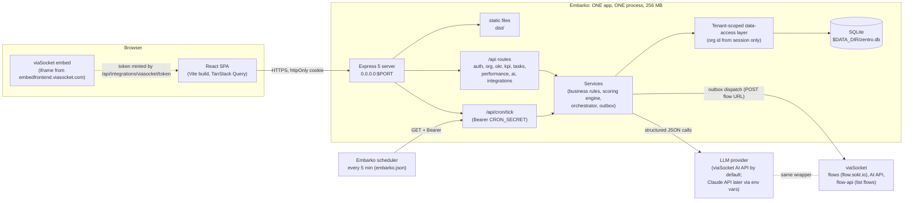

# Zentro: Technical Architecture

Status: **Milestone 0 blueprint, awaiting approval. No application code exists yet.**
Source of truth: `ZENTRO_MASTER_PROMPT.md`. Its "Showcase overrides" section wins over everything else in it. Where reality (Embarko, viaSocket, Curevia) differs from the master prompt, this document says so in section 3 and section 4.

Companion documents: [database-design](database-design.md), [permission-model](permission-model.md), [scoring-architecture](scoring-architecture.md), [agent-specifications](agent-specifications.md), [viasocket-integration](viasocket-integration.md), [frontend-structure](frontend-structure.md), [api-documentation](api-documentation.md), [milestones](milestones.md), [risks](risks.md), [known-limitations](known-limitations.md).

---

## 1. What Zentro is (my understanding)

Zentro connects **strategy → objectives (OKRs) → KPIs → daily tasks → evidence → explainable performance scores** across a whole organization, with a fully dynamic hierarchy (CEO down to intern; no fixed levels).

Four ideas drive every design choice:

1. **Outcomes, not activity.** A score is built from key-result attainment, KPI attainment, delivery reliability and quality or impact. Task count never raises a score by itself.
2. **Deterministic numbers, AI words.** Scores, permissions, statuses and risk flags are plain code with stored inputs. The LLM only explains and recommends, and only over data returned by permission-checked tools.
3. **Missing is not zero.** Absent data is shown as "not enough data". Scores can be `provisional` or `insufficient`.
4. **Scope-based access, data-driven.** Roles and permissions are rows, not code. Access is permission × scope (own / reports / team / department / organization). A job title alone grants nothing.

Showcase target: demonstrate every feature end to end on one live Embarko link, with real database rows (the demo-data button seeds a fictional company; it never hardcodes numbers into the UI).

---

## 2. What I checked, and what I found

| # | Source | Read? | Result |
| --- | --- | --- | --- |
| 1 | Embarko `llms.txt`, `deploy`, `embarko-json`, `data`, `schedules`, `env-vars`, `files`, `status`, `integrations`, `ai`, `automations` (all via `https://embarko.ai/docs/<topic>.md`) | Yes, fully | Details in section 3. The docs **do not state a Node version**. |
| 2 | HireDrive deploy runbook (`ankita34359/Automation_Embed` → `EMBARKO-DEPLOY-RUNBOOK.md`) | Yes, fully (public repo, cloned read-only) | Source of the **proven** Node 20.20.2 facts, the `better-sqlite3@^12` pin, and the archive/upload procedure. |
| 3 | Curevia (`ankita34359/Curevia`) | Yes: `package.json`, `embarko.json`, `.env.example`, README, server (`index`, `app`, `config`, `holding`, `db`, `auth/sessions`, `routes/cron`, `services/viasocket`, `integrations`, `deliveries`, `tick`), client embed page, tests helpers, deploy script | The pattern to copy. **Differences from the master prompt** are in section 4. I read the whole shape, not every one of the 112 files. |
| 4 | Current viaSocket docs (`flow.viasocket.com/documentation/skill.md` v2026-11-20.6, `viasocket.com/docs/embed.md`, `apps-api.md`, `skill/setup.md`, `skill/connect.md`, `skill/alerts.md`, `automations.md`, `ai.md`), npm package `viasocket-apps@0.21.0`, plus two web searches | Yes | **`ViaSocketActionEmbed` and `useGetViaSocketEmbedToken` were not found anywhere.** See [viasocket-integration](viasocket-integration.md) section 1. |

Could not read or verify: anything behind a viaSocket or Embarko login (dashboard "Install Code" snippets, Embarko dashboard pages), and any private viaSocket package. Nothing was guessed to fill those gaps; they appear as open items.

---

## 3. Verified platform facts

Legend: **[used]** = done by you in HireDrive/Curevia and seen working (runbook or Curevia README). **[docs]** = stated in Embarko/viaSocket docs, not exercised by us. **[unproven]** = my plan, needs proof in a named stage.

| Topic | Fact | Status |
| --- | --- | --- |
| Node version | Docs give none. Builder (Railpack 0.38) takes it from `engines.node`; `">=20"` produced **Node 20.20.2**. Everything must install, build and test on 20.20.2. | [used] |
| Build / start | `npm install` → `npm run build` → `npm start`. Needs `package.json` + `package-lock.json` at the archive root. | [used] |
| Build tools | Keep build-time packages (vite, typescript, tailwind, `@types/*`) in `dependencies`; harmless belt-and-braces against `--omit=dev`. | [used] |
| One app | One upload = one process = one app (`kind: service`). Express serves the built React app and `/api`. | [used] |
| Port | Read `PORT`, bind `0.0.0.0`. | [used] |
| Persistence | Only `DATA_DIR` survives redeploys. SQLite file (and `-wal`/`-shm`) goes there. Create the folder on startup. | [used] |
| SQLite rules | Embarko adds tables `_litestream_seq` and `_litestream_lock` to every SQLite file. Use committed migration files; never a schema-diff tool. | [docs] |
| Backups | **None.** "Data is not backed up. Tell the person." | [docs] |
| Memory | 256 MB per app, cannot be raised. | [docs] |
| Not available | WebSockets, background workers, multiple processes, managed databases, backups. | [docs] |
| Schedules | `embarko.json` → `schedules[]`. Max **5** per app, no more often than **every 5 minutes**, each call has **5 minutes** to finish. Embarko calls **GET** with `Authorization: Bearer <CRON_SECRET>`; route must 401 otherwise. Redirects count as failed. Missed times are not replayed. Overlap → run `skipped`. Owner is emailed after 3 consecutive failures. Needs a kept (claimed) app. | [docs]; the 5-min tick + 202-immediately pattern is [used] in Curevia |
| Secrets | Entered on the app's "App setup" page; values are write-only. **Saving is not applying**: press "Apply changes" (restarts the app, no rebuild). Runtime only, not available during `npm run build`. | [used] |
| Frontend build vars | `VITE_*` cannot come from env vars. Put public values in a committed config file. | [docs]; [used] in HireDrive (`src/config.js`) |
| Embarko-set env vars | `PORT`, `APP_NAME`, `APP_VERSION`, `DATA_DIR`, `STORAGE_URL`, `STORAGE_TOKEN`, and `CRON_SECRET` (when schedules exist). Cannot be overridden. | [docs] |
| CSP | Embarko injects its own CSP, allowing `https:` broadly; `embed.viasocket.com` (script) and `embedfrontend.viasocket.com` (frame) were verified in real Chromium. Do not set a CSP in the app. | [used] |
| Deploy method | HTTP multipart `.tar.gz` built with `git archive` + deploy token. The `deploy_app` connector is wrong for a real project (it needs every file's full text; risks corrupting the lockfile). | [used] |
| Temporary apps | A deploy without a claimed token is deleted after 24 h and ignores schedules. | [docs] |
| File storage | `PUT {STORAGE_URL}/apps/{APP_NAME}/files/{name}`. **Every file is public to anyone with the link.** Extensions limited (no html/js/svg). Counts against a plan quota. | [docs] → **unsuitable for confidential evidence** (decision D11) |
| Embarko "Integrations" capability | Turning it on sets `INTEGRATIONS_ORG_ID`, `INTEGRATIONS_PROJECT_ID`, `INTEGRATIONS_SECRET`. Needs a workspace **Owner** to enable "pay as you use". HireDrive and Curevia instead used their own `VIASOCKET_*` vars. | [docs] / [used] |
| Region | Not selectable or guaranteed; point to the DPA if residency matters. | [docs] |

---

## 4. Where the master prompt and reality differ

These are not silent changes. Each is a decision recorded here, and the unresolved ones are repeated in the open questions at the end of my report.

| Master prompt / override says | Reality | What this blueprint does |
| --- | --- | --- |
| Backend is TypeScript (§17) | **Curevia and HireDrive are plain JavaScript.** A compiled TS backend has never been run on Embarko by you. | Compile with `tsc` at build, run compiled JS (D3). Proven in stage 1.1 **before** anything else is built. Fallback: `tsx` at runtime. |
| Auth "like Curevia": signed JWT in httpOnly cookie, scrypt | **Curevia uses opaque DB-backed session ids and bcryptjs, not JWT or scrypt.** | Follow the override (JWT cookie + scrypt), but the JWT only carries a session id that is checked against a `sessions` row, so logout, membership removal and role changes take effect immediately (D6). |
| viaSocket `ViaSocketActionEmbed` + `useGetViaSocketEmbedToken` (§14) | **Not found** in current docs, the `viasocket-apps` npm package (0.21.0), your repos, or web search. | Use the proven script embed `viaSocket.mount()` + server-signed token (already working in Curevia/HireDrive). |
| Curevia pins `viasocket-apps@^0.7.0` | Current is **0.21.0**, and its API changed (`tokenFor` → `user.token()`). `^0.7` never reaches 0.21. | Pin the current version in stage 8.1 and re-run `npx viasocket-apps check`. |
| Evidence "file upload" with "secure file access" (§12, §15) | Embarko file storage is **public by link**. | Confidential evidence goes in SQLite BLOBs behind an authenticated download route, small and capped; external references are stored as links (D11). |
| Hosting "frontend and backend as separate apps if needed" (§17) | Override §5 says one app. | One app (D2). |
| Postgres, Prisma, RLS (§15–17) | Overridden | SQLite + SQL migrations + a tenant-scoped data-access layer + isolation tests (D1). Recorded in [risks](risks.md). |
| Express | Curevia uses 4.22, HireDrive 5.3, both worked on Embarko | Express 5 (native async error handling) (D4). |
| Vitest | **Vitest 5 requires Node ≥ 22.12; `better-sqlite3@13` requires Node ≥ 22.** Both would break on Embarko's Node 20. | Pin `vitest@^4.1.12` (3.x was the first plan; changed in stage 1.1 for audit advisories) and `better-sqlite3@^12.11` (both [used]). A CI-style script scans the lockfile for packages needing Node > 20. |
| Model names | Curevia's list (`gpt-5-mini`, `claude-sonnet-4-6`) is older than viaSocket's current `ai.md` (`gpt-6-luna`, `claude-sonnet-5-5`, …) | Model ids are environment variables, re-checked against `ai.md` at stage 7.1. |

---

## 5. System architecture



Reading the diagram: there is exactly one process. Anything asynchronous (outbox dispatch, retries, reminders, overdue checks, risk scans, KPI threshold sweeps, agent-run recovery) is triggered by the 5-minute tick or by a user request that kicks off an in-process job and records it as a durable row (section 9).

---

## 6. Technology stack and pinned versions

All versions were checked against the npm registry on 2026-11-21 for Node 20 compatibility. "Pin" means a semver range that cannot cross into a Node-22-only major.

| Layer | Choice | Pin / note | Node 20.20.2 check |
| --- | --- | --- | --- |
| Runtime | Node.js | `engines.node: ">=20"` → 20.20.2 | [used] |
| Language | TypeScript | `~5.9.3`. **Not 7.x**: 7 is a new native-binary compiler shipped through platform-specific optional packages, which no Embarko deploy has exercised. | pure JS, `>=14.17` |
| Server | Express | `^5.3.0` | `>=18` [used] |
| DB | `better-sqlite3` | **`^12.11.1`** (13.x needs Node ≥ 22) | [used] |
| Validation | Zod | `^4.6.7`, schemas in `shared/` used by server and client | no engine limit |
| Auth | Node `crypto.scrypt` (passwords), `jsonwebtoken` `^9.0.3` (session cookie + embed token), `cookie-parser`, `helmet`, `express-rate-limit` | pure JS | all `>=12..18` |
| Frontend | React `19.3`, **React Router `^7.18`** (not 8: `react-router@8` needs Node >= 22.22; changed in 1.3), TanStack Query `5`, **`motion ^14` (used through `LazyMotion` and the tiny `m` components; added in 1.4)**, `@radix-ui/react-dialog` + `react-slot`, `class-variance-authority`, `clsx`, `tailwind-merge`, `lucide-react`, `@fontsource-variable/inter`; React Hook Form + `@hookform/resolvers` and Recharts `3` arrive with their first use | `react-router@7` needs `>=20`; ok |
| Build | Vite `^8.3`, `@vitejs/plugin-react ^6`, Tailwind `^4.3` + `@tailwindcss/vite` | Vite 8 needs `^20.19 || >=22.12`; 20.20.2 satisfies it. If Embarko ever picks 20.18 or older the build fails, so stage 1.1 checks `node -v` in the build log. | [used] in HireDrive |
| UI kit | shadcn/ui (components copied into `frontend/src/components/ui`) | The `shadcn` CLI (`>=20.18.1`) is a dev-time tool run in the build session; it is not a runtime dependency. | n/a |
| Tests | `vitest ^4.1.12` (changed from `^3.2` in stage 1.1: 3.x had npm-audit advisories in `tinypool`/`@vitest/mocker`), `supertest`, **`jsdom ^28.1`** (jsdom 29+ needs Node >= 22), `@testing-library/react` + `user-event` (no `jest-dom`: its 6.x/8.x need Node >= 22, tests use plain DOM assertions) | Vitest 5 would break on Node 20; 4.1.12 allows `^20`. | proven on 20.20.2 in stages 1.1 to 1.3 |
| AI | `viasocket-apps` (current, pinned exact) behind our own `AiProvider` interface | `>=20` | |

Rule from the runbook: every dependency's own `engines.node` must accept 20.20.2. A script (`scripts/check-node20.mjs`, stage 1.1) scans `package-lock.json` for any package whose `engines.node` excludes 20 and fails the build. All tests run under a real Node 20.20.2 binary, not the sandbox's Node 22.

---

## 7. Repository layout

One root `package.json` (Embarko requires it at the archive top level). Folder names follow master §25; the Curevia pattern is otherwise kept.

```
zentro/
├── package.json  package-lock.json  tsconfig.base.json
├── embarko.json                    # appId (after first deploy) + one 5-minute schedule
├── .env.example  .gitignore        # .env, node_modules, dist, build, data/ ignored
├── frontend/                       # Vite root (see frontend-structure.md)
│   ├── index.html
│   └── src/{components,layouts,pages,hooks,services,contexts,types,config,App.tsx}
├── backend/
│   ├── tsconfig.json
│   └── src/
│       ├── server.ts               # config → holding page or app → listen(PORT,'0.0.0.0')
│       ├── app.ts                  # middleware order, routers, static, error handler
│       ├── config/                 # env parsing (Zod), holding app
│       ├── db/                     # open(), migrate(), tenant-scoped repositories
│       ├── middleware/             # session, tenant ctx, permission, rate limit, errors
│       ├── modules/                # auth, organizations, employees, hierarchy, objectives,
│       │                           # kpis, tasks, evidence, performance, mentorship,
│       │                           # ai, integrations, notifications, admin, demo
│       ├── scoring/                # PURE engine: no db, no clock, no AI (scoring-architecture.md)
│       ├── agents/                 # orchestrator.ts, tools/, six *.agent.ts, provider/
│       ├── integrations/viasocket/ # token, flows, dispatcher, ai provider
│       ├── jobs/                   # tick.ts + job registry (overdue, outbox, risk scan…)
│       └── lib/                    # ids, time, crypto, http errors, logger
├── shared/                         # Zod schemas, enums, types used by both sides
├── database/
│   └── migrations/                 # 0001_init.sql … (plain SQL, append-only)
├── scripts/                        # embarko-deploy.sh, check-node20.mjs, seed helpers
├── tests/                          # vitest: unit, api, tenancy, permissions, scoring golden
├── docs/                           # this blueprint + deployment.md (M9)
├── PROGRESS.md
└── README.md
```

Build and start (details are firm, versions as in section 6):

```jsonc
{
  "type": "module",
  "engines": { "node": ">=20" },
  "scripts": {
    "build": "tsc -p backend/tsconfig.json && vite build --config frontend/vite.config.ts",
    "start": "node build/backend/src/server.js",
    "dev:server": "tsx watch backend/src/server.ts",   // tsx is devDependency only
    "dev:client": "vite --config frontend/vite.config.ts",
    "test": "vitest run",
    "check:node20": "node scripts/check-node20.mjs",
    "check:viasocket": "npx viasocket-apps check backend frontend/src"
  }
}
```

The Vite build writes to `dist/` (frontend) and `tsc` writes to `build/` (server), so neither overwrites the other. Express serves `dist/`, with `index.html` as the single-page-app fallback for non-`/api` GETs. Migration files are read from `database/migrations/` resolved from the compiled file's location, so they must be in the archive (they are tracked files).

---

## 8. Backend layering and rules

```
HTTP route (Express router, one per module)
  → validate: Zod schema from shared/ (body, query, params). Reject unknown fields.
  → authenticate: session middleware → ctx
  → authorize: requirePermission('okr.edit') + object-level scope check
  → service function (business rules, transactions, audit, outbox enqueue)
  → repository functions (SQL; ONLY place SQL lives; every function takes ctx)
  → better-sqlite3 (synchronous, one connection, WAL)
```

Rules (each has a test or a lint check):

1. **`ctx` is the only source of tenant identity.** `ctx = { userId, membershipId, organizationId, sessionId, requestId }`, built from the session row. No route reads an organization id from a body, query or URL to decide access. URLs may contain entity ids; the repository always adds `AND organization_id = ctx.organizationId`.
2. **SQL lives only in repositories.** A test greps `backend/src/modules/**` outside `repositories/` for `db.prepare` and fails the build if it finds any. A second test parses repository SQL strings and fails if a statement on an organization-owned table lacks an `organization_id` predicate (allow-list for the few global tables: `permissions`, `schema_migrations`).
3. **Cross-tenant access returns 404, not 403**, so existence is not leaked.
4. **One transaction per business operation.** The business change, its `audit_logs` row and any `automation_events` + `automation_outbox` rows commit together (`db.transaction`). Nothing external is called inside a transaction.
5. **Append-only history.** KPI measurements, objective progress, score runs, task updates, audit logs, reporting relationships are inserted, never updated in place. Corrections insert a new row that references the one it supersedes.
6. **Soft delete / archive.** `archived_at` (organizational and goal entities) or terminal status; nothing a score or history refers to is hard-deleted. Demo-data removal is the one hard-delete path and is restricted to `is_demo = 1` rows.
7. **Errors** use one envelope (see [api-documentation](api-documentation.md) section 1). Unhandled errors log method, path, request id and message only, never bodies or tokens.
8. **The frontend is never an authority** for permissions or calculations; it hides UI for convenience only.

---

### 8.1 What stage 1.2 built (backend foundation)

| Piece | Where | Behaviour |
| --- | --- | --- |
| Config + holding mode | `backend/src/config/{env,holding}.ts` | Required: `SESSION_SECRET`, `ENCRYPTION_KEY`; optional `APP_URL`, `LOG_LEVEL`, `TRUST_PROXY`. Names only in every message. |
| Request id, logger, error envelope | `backend/src/http/*`, `lib/logger.ts` | `X-Request-Id` on every answer; JSON log lines with the route pattern (never the real path, body, query or headers); sensitive field names redacted; every error uses `{error:{code,message,details?},meta:{requestId}}`. |
| Route registry | `backend/src/http/registry.ts` | Every route is added with an access marker: `public` (with a reason), `cron`, `baseline`, or `permission(key)`; Zod validation of params/query/body; boot check that no route bypasses the registry. Until sessions exist (2.1) `baseline` and `permission` routes fail closed with 401. |
| Tenant data layer | `backend/src/db/{tenant,sqlLint}.ts` | `createTenantDb(db, ctx)` binds `@organization_id` from the session context; **strict mode** (tests, or `ZENTRO_STRICT_TENANT=1`) lints each statement and checks every returned row. SQL is allowed only in `db/` and `modules/*/repositories/` (a test enforces it). |
| Migrations | `backend/src/db/migrate.ts` | Checksums, pre-migration copy, unknown-applied report. |
| Jobs | `backend/src/jobs/*`, `db/jobRuns.ts`, migration `0002` | `JobRegistry` + `createTick` (one at a time, 200 s budget, 10 min stale limit, per-job `minIntervalSeconds`, `scheduled_job_runs` rows for every tick and job). Jobs now: `platform.heartbeat` (spike tick counter), `platform.housekeeping` (daily prune). |
| Frontend shell (1.3) | `frontend/src/*` | Tailwind 4 tokens (light and dark), `AppShell` (fixed sidebar from 1024 px, slide-in sheet below), eleven-item navigation (`routes/navigation.ts`, with the permission key each item will need), routes lazy-loaded per page, theme provider, API client that reads the envelope, `useHealth` over `/healthz`. Details in [frontend-structure](frontend-structure.md) section 10. The 1.1 spike page, its two routes and the heartbeat job are gone; the `spike_counters` table stays one release (dropped later) so a rollback still works. |
| Field encryption | `backend/src/lib/crypto.ts` | AES-256-GCM, key derived from `ENCRYPTION_KEY`. Not used for stored data until stage 8. |

---

## 9. Asynchronous work (no workers, no WebSockets)

Embarko offers one process and a scheduler. The proven pattern from Curevia is copied and generalized.

**The tick.** `embarko.json` declares one schedule: `GET /api/cron/tick` every 5 minutes (one of the 5 allowed, leaving 4 spare). The route:

1. Requires `Authorization: Bearer $CRON_SECRET` (constant-time compare); always 401 if `CRON_SECRET` is unset.
2. Takes an in-process lock; if a tick is running, answers `202 {started:false, skipped:"already running"}`.
3. Answers **202 immediately** and does the work in the background (Embarko gives up after 300 s; Curevia proved this shape). A lock older than 10 minutes is treated as dead; a tick stops starting new work after 200 s.

**Job registry.** The tick walks a registry of jobs, each with `name`, `minIntervalSeconds`, `run(now, budget)`. Last run and summary are stored in `scheduled_job_runs`, so jobs can run less often than every 5 minutes (hourly, daily at 08:00 in the organization's timezone, weekly) without extra Embarko schedules.

| Job | Interval | Does |
| --- | --- | --- |
| `outbox.dispatch` | every tick | Sends due `automation_outbox` rows to viaSocket, retries with backoff. |
| `tasks.overdue` | every tick | Marks tasks overdue, enqueues `task.overdue`, `task.due_soon` events (deduped by key). |
| `agents.recover` | every tick | Runs stuck `queued`/`running` rows past a timeout: mark `failed(interrupted)` or re-queue once. |
| `kpi.thresholds` | hourly | Re-checks measurements for crossed thresholds; flags missed measurement periods. |
| `risk.scan` | hourly | Deterministic risk detectors; AI explanation for new high-severity findings only (capped per tick). |
| `reviews.reminders` | daily 08:00 org-local | Weekly/periodic review due reminders. |
| `scores.recalculate` | nightly | Recomputes open-period scorecards (new immutable score run only if inputs hash changed). |
| `housekeeping` | daily | Purge expired sessions/tokens, trim `agent_run_steps` payloads, SQLite checkpoint. |

**User-triggered long work** (AI runs, score recalculation for a department) follows one pattern: the POST inserts a durable row (`agent_runs.status='queued'`), responds `202` with the run id, starts the work in-process (`setImmediate`), and the UI **polls** `GET …/runs/:id` (no WebSockets). If the process restarts mid-run, `agents.recover` finishes the story. Doing work after the response is proven for the tick but not documented as guaranteed by Embarko, so **every job is idempotent and recoverable from its row**.

**Latency to tell users:** anything asynchronous takes up to ~5 minutes to be noticed unless a request kicks it immediately (the outbox is also kicked right after commit, best effort).

---

## 10. Data persistence and migrations

- DB file: `path.join(DATA_DIR, 'zentro.db')`; WAL mode, `foreign_keys=ON`, `busy_timeout=5000`.
- Migrations: `database/migrations/NNNN_name.sql`, applied at startup in order inside one transaction each, tracked in `schema_migrations(id, name, checksum, applied_at)`. A released migration is never edited (checksum mismatch fails startup loudly, **before** any pending migration runs). **Before applying a pending migration to a database that already has data, the runner writes a consistent copy (`VACUUM INTO`) to `$DATA_DIR/backups/pre-NNNN-<time>.db` and keeps the newest three** (built in 1.2). Embarko's two `_litestream_*` tables are never touched.
- SQLite cannot alter CHECK constraints or drop most constraints; Curevia had to rebuild a table for that. So **no CHECK constraints on enumerations that may grow**; allowed values live in `shared/` Zod enums and are validated on write. CHECKs are used only for stable invariants (`value IN (0,1)`, `weight >= 0`). Where a rebuild is unavoidable, the runner copies the DB file before applying (as Curevia does).
- Portability to Postgres: text UUID keys, ISO-8601 UTC text timestamps, 0/1 integers for booleans, `_json` text columns validated by Zod, no `AUTOINCREMENT`, no SQLite-specific functions in repository SQL except isolated helpers.
- **Backups do not exist on Embarko.** M9 adds an admin "Export all data" (JSON per table) and a nightly consistent snapshot copy inside `DATA_DIR` (last 3). The snapshot protects against a bad migration or deletion, **not** against loss of the volume, and the UI says so ([risks](risks.md) R-09).

---

## 11. Configuration and secrets

Secrets go **only** on Embarko's App setup page (never in the repo or chat); the app never prints values, only names of missing variables.

| Variable | Set by | Required | Purpose |
| --- | --- | --- | --- |
| `PORT`, `DATA_DIR`, `APP_NAME`, `APP_VERSION`, `CRON_SECRET` | Embarko | auto | see section 3 |
| `NODE_ENV=production` | you | yes (prod) | cookie `Secure`, refuse demo seed scripts locally in prod |
| `APP_URL` | you | **still optional after 2.1** (was planned as required) | public origin, no trailing slash; used for the same-origin check and links in emails. Validated if set. Kept optional in 2.1: without it the same-origin check compares with the request's own `Host` / `X-Forwarded-Host`, so a missing variable can never put the live site into holding mode. It becomes required when emailed links arrive (2.2). |
| `SESSION_SECRET` | you | yes | ≥ 32 chars; signs session JWTs |
| `ENCRYPTION_KEY` | you | yes | A long random string (at least 32 characters, different from `SESSION_SECRET`; a password-manager value works). The AES-256 key is derived from it with HKDF-SHA256, so it does not have to be raw base64 bytes. Used for AES-256-GCM on stored viaSocket secrets (flow URLs, `auth_id`s). *Changed in 1.2 from "32 random bytes (base64)": easier to type, same strength.* |
| `REGISTRATION_MODE` | you | no | `code` with `REGISTRATION_CODE` (at least 8 characters) is the live setting (owner decision 3). `open` only when set explicitly. **Unset, wrong or incomplete means closed** (fail closed): registration is refused with a generic message, the rest of the site is unaffected and the server never goes into holding mode because of it. `invite_only` arrives with 2.2. Changed in 2.1 from "default open". |
| `VIASOCKET_ORG_ID`, `VIASOCKET_PROJECT_ID`, `VIASOCKET_EMBED_SECRET` | you | for integrations | falls back to `INTEGRATIONS_*` if Embarko's capability is used |
| `VIASOCKET_EMAIL_FLOW_URL` | you | optional, **not read before stage 8** | platform email flow for password reset / invitation emails. Owner decision (2.2): no email now; administrators copy links. The one plug-in point is `backend/src/modules/auth/delivery.ts` (`LinkDelivery`); stage 8 supplies an outbox-backed implementation and reads this variable |
| `AI_PROVIDER` | you | optional | `viasocket` (default when viaSocket is configured) / `anthropic` / `none` |
| `AI_SERVICE_*`, `AI_MODEL_FAST`, `AI_MODEL_REASONING`, `ANTHROPIC_API_KEY` | you | optional | see [agent-specifications](agent-specifications.md) section 2 |
| `AI_REDACTION` | you | optional | `refs` (default) or `names`; see agent-specifications |
| `TRUST_PROXY` | you | optional | default `1` |
| `LOG_LEVEL` | you | optional | default `info` |

**Holding page (built in 1.2).** If a required variable is missing or invalid the server still starts and listens: `/healthz` answers `ok:true, ready:false` with the names, `/api/*` answers `503 server_missing_settings` with the message `Server is missing: NAMES` (and `details.missing`), the site address shows a plain HTML notice (HTTP 200 so the platform sees a live process), the cron route authenticates and does nothing, and **the database is not opened**. Values are never echoed, only names and a fixed reason (for example "must be at least 32 characters"). The same process becomes the real app after **Apply changes** restarts it. This is the Curevia/HireDrive behaviour that made "secrets not applied yet" obvious from outside.

Frontend config: a committed `frontend/src/config/public.ts` for non-secret values only.

---

## 12. Authentication in one page

Full model in [permission-model](permission-model.md). Summary:

- Register (creates user), create organization (creator becomes Owner), login, logout, password reset, invitations (code or link), session expiry (7 days sliding to 30 days max, configurable).
- Passwords: `crypto.scrypt` (N=16384, r=8, p=1, 16-byte salt, 64-byte key), stored as `scrypt$N$r$p$salt$hash`, async API only, `timingSafeEqual`. Min length 10. Login rate limit per IP + per account with exponential backoff.
- Session: random `session id` stored hashed in `sessions` (with `active_organization_id`). Cookie `zentro_session` is a **JWT (HS256) signed with `SESSION_SECRET`** holding `{sub, sid, iat, exp}`, `httpOnly`, `SameSite=Lax`, `Secure` in production. Every request verifies the JWT and loads the session row; revoking the row ends the session immediately.
- CSRF: `SameSite=Lax` + same-origin check on every non-GET (`Origin`/`Referer` must match `APP_URL`), JSON-only bodies.

---

## 13. Observability and operations

- Structured JSON logs to stdout (Embarko exposes ~8 KB of recent log per stream, so logs are terse): level, time, request id, route, status, duration. Never log bodies, tokens, emails or webhook URLs.
- `GET /healthz` (no auth): `{ok, ready, version, migrations, db}`; used by the post-deploy smoke test.
- Startup log prints `Database: <path>`, Node version, migration count, which optional integrations are configured (names only).
- Tick summary line per run; failures also stored in `scheduled_job_runs`.
- Admin "System" panel (settings): last tick, job table, outbox backlog, last errors.

---

## 14. Testing strategy

Everything runs on **real Node 20.20.2** (`npm i node@20.20.2` into a temp dir, as in the runbook) before each deploy.

| Suite | Proves |
| --- | --- |
| Unit: `scoring/` golden vectors | Weighted formula (the 85/90/80/90 → 86.5 vector), missing-data renormalization, role models, reproducibility from stored inputs |
| API (supertest, in-memory SQLite) | Every route's validation, auth, permission and scope, using a fixture org with a real hierarchy |
| **Tenancy matrix** (generated from the route registry) | For every route taking an entity id: org B user vs org A ids → 404; list endpoints never include org A rows; writes never touch org A |
| **Permission matrix** | Employee / manager / department head / CEO / admin / intern against every permission-protected route |
| Migrations | Fresh DB and upgrade path both reach the same schema; checksum guard |
| Outbox | Atomicity (rollback drops event), dedupe, retry/backoff, idempotency key, `HTTP 200 with error body` counted as failed |
| AI (fake provider) | Routing, Zod validation, grounding check (ungrounded insight dropped), approval required for writes, "AI is not configured" |
| UI (jsdom) | Permission-driven nav, empty/error/loading states for key pages |
| Node-20 gate | Lockfile engines scan; build + tests under Node 20.20.2 |

Live checks on the Embarko link are listed per stage in [milestones](milestones.md).

---

## 15. Deployment procedure (adapted from the HireDrive runbook)

1. Commit. Tree must be clean (`git archive` ships `HEAD` only).
2. `scripts/embarko-deploy.sh <app-name>` (copied from Curevia/HireDrive): `git archive` → refuses `.env`, `node_modules`, `dist`, `data` → uploads `.tar.gz` with the deploy token (from `DEPLOY_TOKEN` or `~/.embarko/credentials`; **I will need you to place it; I never print it**) → polls status → on failure prints the build log.
3. First deploy only: write the reply's `app.id` into `embarko.json` as `appId` and commit.
4. Secrets: you type them on the App setup page, then press **Apply changes**.
5. Smoke test: `/healthz`, one login, the stage's live checklist.
6. Roll back with Embarko's rollback if needed (DATA_DIR is **not** rolled back, so migrations must stay backward-safe for one version).

I do not deploy and do not merge to `main` without asking you first.

---

## 16. Decision log

| ID | Decision | Why | Revisit |
| --- | --- | --- | --- |
| D1 | SQLite (`better-sqlite3@^12`), SQL migrations, no ORM | Override; proven on Embarko | Postgres when scale demands |
| D2 | One Express app serving SPA + API | Override; Curevia | — |
| D3 | `tsc` → `build/`, run compiled JS | Typed backend (master §17) with no runtime loader; Railpack just runs `npm run build` | If stage 1.1 fails: `tsx` runtime, then plain JS |
| D4 | Express 5 | Async errors without wrappers; HireDrive proved on Embarko | — |
| D5 | Tailwind 4 + `@tailwindcss/vite` | HireDrive proved; shadcn targets v4 | — |
| D6 | JWT cookie + server session row | Override asks JWT; revocation needs a row | Confirm with you (open question) |
| D7 | scrypt via `node:crypto` | Override; no native dep | — |
| D8 | One `/api/cron/tick` + job registry | 5-schedule and 5-minute limits | — |
| D9 | `AiProvider` interface; viaSocket default | Override | Add Anthropic provider when you want |
| D10 | Orchestrator runs the tool loop in-process; viaSocket `extra_tools` unused | viaSocket calls tools over public HTTP from its servers and always has web/browser on; in-process tools keep every call inside the asking user's `ctx` | — |
| D11 | Evidence files: capped SQLite BLOBs + authenticated route; links for the rest | Embarko file store is public | If you accept public links for non-confidential demo files |
| D12 | "Person" = `organization_memberships.id` everywhere in org data | A user can belong to several organizations | — |
| D13 | One viaSocket project (env vars) for the platform; per-organization identity via `unique_identifier = zentro-org-<organization_id>` | Matches how embed tokens work; no per-tenant secrets to manage in a showcase | Per-tenant projects later |
| D14 | Hierarchy, team and role assignments are effective-dated rows | Master §3, §20.9: preserve history, multiple managers | — |
| D15 | UUID text ids generated in app (`crypto.randomUUID()`) | Portable | — |
| D16 | No CHECK on growing enums | SQLite cannot alter them | — |
| D17 | Outbox row written in the same transaction as the business change | Master §14.D | — |
| D18 | Scoring is a pure function over a stored input snapshot | Reproducibility (§20.4) | — |
| D19 | Demo data = `is_demo = 1` rows in the real tables | Override §8 | — |
| D20 | All tests and builds verified on real Node 20.20.2 | Runbook lesson | — |
