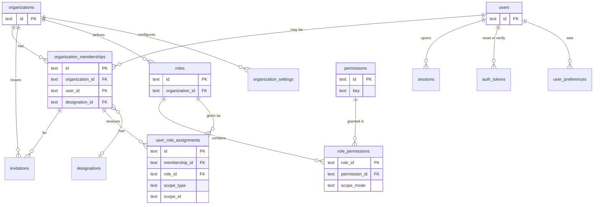
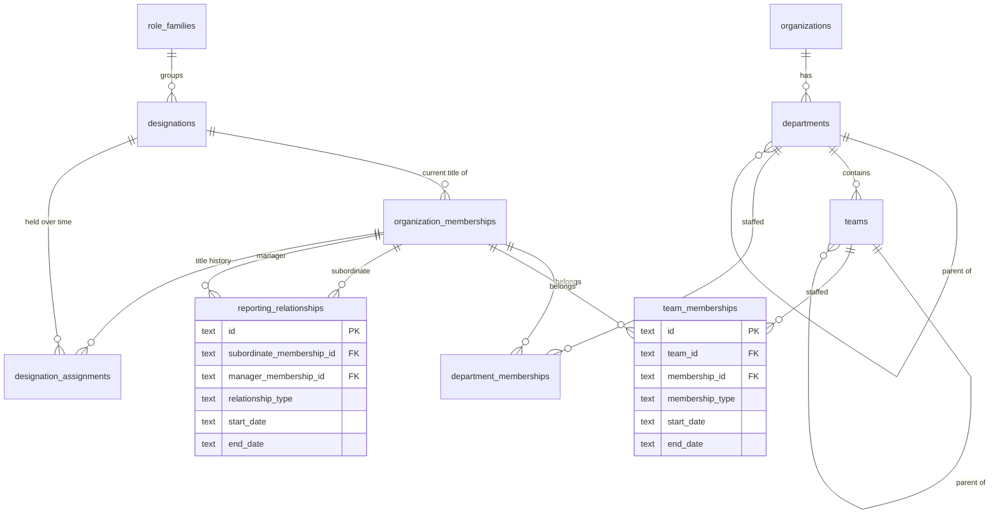
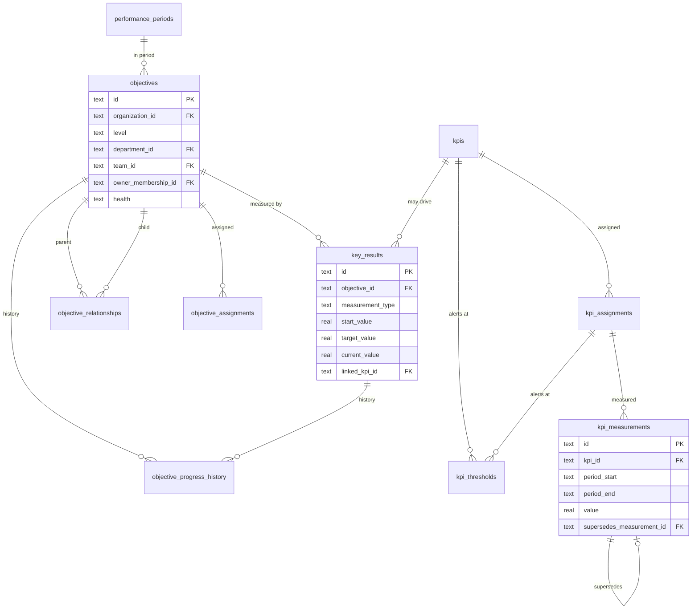
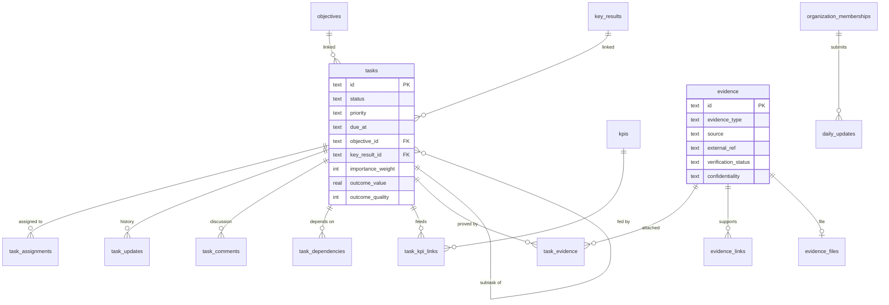
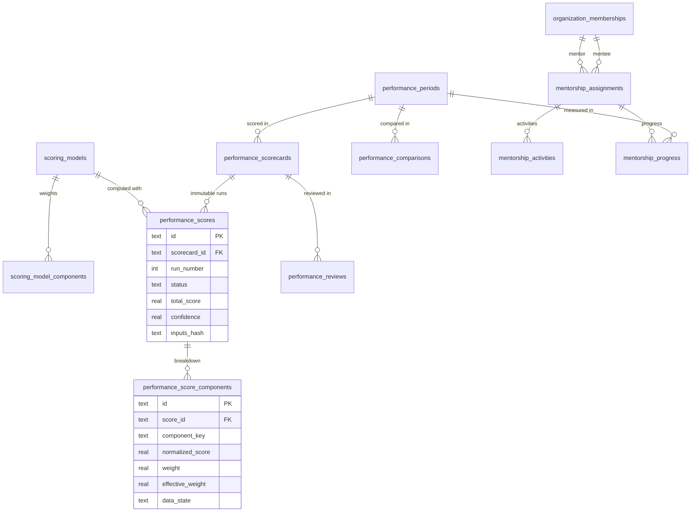
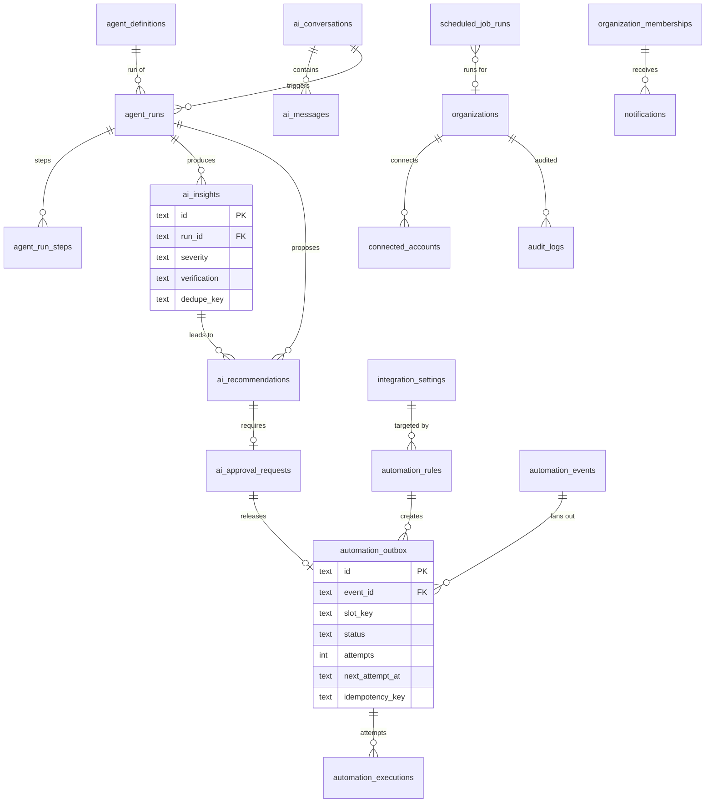

# Zentro: Database Design

Engine: **SQLite via `better-sqlite3@^12.11`**, file at `$DATA_DIR/zentro.db`. Schema is plain SQL in `database/migrations/NNNN_name.sql`, applied at server start and tracked in `schema_migrations`. There is no ORM and no `schema.prisma`. This replaces the Prisma/PostgreSQL parts of master sections 16, 17 and 25 (showcase override 2).

Every entity in master section 16 is present (checklist in section 7). Entities marked **(added)** are refinements the master prompt allows ("refine the schema when necessary") and needs for a stated requirement.

---

## 1. Conventions (apply to every table unless noted)

| Rule | Detail |
| --- | --- |
| Primary key | `id TEXT PRIMARY KEY`, a UUID v4 generated in the app (`crypto.randomUUID()`). Never `AUTOINCREMENT`. |
| Tenant column | `organization_id TEXT NOT NULL REFERENCES organizations(id)` on **every organization-owned table**, including link tables. Global tables: `permissions`, `schema_migrations`, `users`, `sessions`, `auth_tokens`, `organizations` itself. |
| Timestamps | `created_at TEXT NOT NULL`, `updated_at TEXT NOT NULL` (ISO-8601 UTC, e.g. `2026-11-21T09:30:00.000Z`). Append-only tables have `created_at` only. Calendar dates (deadlines, effective dates) are `TEXT` `YYYY-MM-DD`. |
| Booleans | `INTEGER` 0/1. |
| Money / numbers | Measured values are `REAL`; currency KPI values are stored in the major unit with the unit label on the KPI. Score arithmetic is done in code with explicit rounding rules ([scoring-architecture](scoring-architecture.md)). |
| JSON | `TEXT` column named `*_json`, validated by a Zod schema in `shared/` on every write. Used only for flexible structured data: config, snapshots, payloads, supporting data. |
| Archive / soft delete | `archived_at TEXT NULL` on organizational and goal entities. History tables are never deleted. Only demo-data removal hard-deletes, and only rows with `is_demo = 1`. |
| Demo flag | `is_demo INTEGER NOT NULL DEFAULT 0` on business tables that the demo seed writes. |
| Enumerations | Stored as `TEXT`, validated by Zod enums in `shared/`. **No `CHECK` on enums that may grow** (SQLite cannot alter CHECKs; Curevia had to rebuild a table for this). `CHECK` only for stable invariants: booleans, `weight >= 0`, the "exactly one of these FKs is set" rule on assignee columns. |
| "Exactly one assignee" | Where something can be assigned to a person, a team or a department, there are separate nullable FK columns with `CHECK ((a IS NOT NULL) + (b IS NOT NULL) + (c IS NOT NULL) = 1)`. This keeps real foreign keys instead of an untyped `(type, id)` pair. |
| Person identity | Inside an organization a person is **`organization_memberships.id`** (columns named `*_membership_id`). A `users` row is a login; one user can belong to several organizations. A membership can exist before its user does (an invited employee already appears on the org chart). |
| History | Effective-dated rows (`start_date`, `end_date NULL` = current). Corrections insert a new row that points at the one it supersedes. Nothing a past score refers to is overwritten. |
| Portability | No `AUTOINCREMENT`, no `WITHOUT ROWID`, no SQLite-only functions in repository SQL (date arithmetic is isolated in helpers), partial and expression indexes only where Postgres has the same syntax. |

---

## 2. Entity-relationship diagrams

The overview shows how the domains connect. Each domain has its own diagram below it. Column lists are in section 3.

### 2.1 Overview

```mermaid
erDiagram
  organizations ||--o{ organization_memberships : "has people"
  users ||--o{ organization_memberships : "logs in as"
  organization_memberships ||--o{ user_role_assignments : "granted"
  roles ||--o{ user_role_assignments : "assigned"
  organization_memberships }o--|| designations : "holds"
  designations }o--o| role_families : "compared within"
  departments ||--o{ teams : "contains"
  teams ||--o{ team_memberships : "members"
  organization_memberships ||--o{ team_memberships : "joins"
  organization_memberships ||--o{ reporting_relationships : "reports to"
  organizations ||--o{ objectives : "owns"
  objectives ||--o{ key_results : "measured by"
  objectives ||--o{ objective_relationships : "aligned via"
  objectives ||--o{ tasks : "driven by"
  key_results ||--o{ tasks : "driven by"
  kpis ||--o{ kpi_assignments : "assigned"
  kpi_assignments ||--o{ kpi_measurements : "measured"
  tasks ||--o{ task_assignments : "assigned"
  tasks ||--o{ task_evidence : "proved by"
  evidence ||--o{ task_evidence : "supports"
  organization_memberships ||--o{ performance_scorecards : "scored as"
  performance_periods ||--o{ performance_scorecards : "in"
  performance_scorecards ||--o{ performance_scores : "runs"
  performance_scores ||--o{ performance_score_components : "explained by"
  organization_memberships ||--o{ mentorship_assignments : "mentors or is mentored"
  agent_definitions ||--o{ agent_runs : "executed as"
  agent_runs ||--o{ ai_insights : "produces"
  ai_insights ||--o{ ai_recommendations : "suggests"
  ai_recommendations ||--o| ai_approval_requests : "needs"
  automation_events ||--o{ automation_outbox : "dispatched via"
  automation_outbox ||--o{ automation_executions : "attempts"
  organizations ||--o{ audit_logs : "audited"
  organizations ||--o{ notifications : "notifies"
```

### 2.2 Identity, access and organization

### 2.3 Hierarchy

### 2.4 Objectives, OKRs and KPIs

### 2.5 Tasks and evidence

### 2.6 Performance and mentorship

### 2.7 AI, integrations and communication

---

## 3. Tables and columns

Notation: `col` = column; `FK→t` = foreign key; **UQ** = unique; `?` = nullable. Every organization-owned table also has `organization_id FK→organizations`, `created_at`, and (unless append-only) `updated_at`; these are not repeated below.

### 3.1 Organization and identity

| Table | Columns | Notes |
| --- | --- | --- |
| `organizations` | `name`, `slug` UQ, `timezone` (IANA, default `UTC`), `fiscal_year_start_month`, `status`, `created_by_user_id` FK→users, `archived_at?` | Not tenant-scoped (it *is* the tenant). |
| `users` | `email` UQ NOCASE, `password_hash?`, `name`, `email_verified_at?`, `status`, `is_platform_admin`, `last_login_at?`, `is_demo` | A login. `password_hash` NULL for demo personas. |
| `organization_memberships` | `user_id?` FK→users, `display_name`, `work_email?`, `employee_code?`, `designation_id?` FK, `employment_type`, `start_date?`, `end_date?`, `status` (invited, active, suspended, left), `timezone?`, `archived_at?`, `is_demo` | UQ(`organization_id`,`user_id`) where `user_id` not null. The person identity used by all org data. |
| `invitations` | `membership_id` FK, `email`, `code_hash` UQ, `initial_role_id?` FK→roles, `invited_by_membership_id` FK, `expires_at`, `accepted_at?`, `revoked_at?` | Code shown once; only the hash is stored. |
| `roles` | `key`, `name`, `description`, `kind` (template, custom), `archived_at?` | UQ(`organization_id`,`key`). Seeded per organization from templates, fully editable. |
| `permissions` | `key` UQ (e.g. `okr.edit`), `module`, `description`, `allowed_scope_modes_json`, `is_sensitive` | **Global**, seeded by migration. Code references keys; roles are data. |
| `role_permissions` | `role_id` FK, `permission_id` FK, `scope_mode` | PK(`role_id`,`permission_id`). `organization_id` repeated so the tenant check applies. |
| `user_role_assignments` | `membership_id` FK, `role_id` FK, `scope_type` (organization, department, team, self), `scope_id?`, `valid_from`, `valid_to?`, `granted_by_membership_id` FK, `revoked_at?` | The scope-based access rows; see [permission-model](permission-model.md). |
| `sessions` **(added)** | `id` (hash of session id), `user_id` FK, `active_organization_id?` FK, `created_at`, `last_seen_at`, `expires_at`, `absolute_expires_at`, `impersonated_by_user_id?`, `revoked_at?` | Global. Checked on every request. |
| `auth_tokens` **(added)** | `user_id` FK, `purpose` (password_reset, email_verify), `token_hash` UQ, `expires_at`, `used_at?` | Global. |
| `organization_settings` **(added)** | `key`, `value_json`, `updated_by_membership_id?` | UQ(`organization_id`,`key`). AI settings, review cadence, notification defaults, data-sufficiency defaults, registration policy. |
| `user_preferences` | `user_id` FK, `organization_id?`, `key`, `value_json` | UQ(`user_id`,`organization_id`,`key`). Notification preferences (`notify.<event>.<channel>`), theme, last date range. |

### 3.2 Organization hierarchy

| Table | Columns | Notes |
| --- | --- | --- |
| `role_families` **(added)** | `key`, `name`, `description`, `comparison_enabled`, `archived_at?` | The **peer cohort key**: "Software Engineer", "Project Manager", "Mentor". Peers are compared only within a family. |
| `designations` | `name`, `seniority_level` (integer), `role_family_id?` FK, `is_executive`, `default_role_id?` FK, `default_scoring_model_id?` FK, `description`, `archived_at?` | Custom titles and levels. A new "level" is just a new row. |
| `designation_assignments` **(added)** | `membership_id` FK, `designation_id` FK, `start_date`, `end_date?`, `reason?`, `created_by_membership_id` FK | Effective-dated job titles. `organization_memberships.designation_id` is a cached copy of the open row. Peer cohorts and scoring models are resolved **as of the period end** from this table. |
| `departments` | `parent_department_id?` FK (self), `name`, `code?`, `description`, `sort_order`, `archived_at?` | Self-parent allows extra levels above teams. |
| `teams` | `department_id` FK, `parent_team_id?` FK (self), `name`, `purpose`, `archived_at?` | Sub-teams via `parent_team_id`. |
| `department_memberships` **(added)** | `department_id` FK, `membership_id` FK, `membership_type` (head, deputy, member), `start_date`, `end_date?` | Effective-dated. Needed to preserve "who headed Engineering in Q2". |
| `team_memberships` | `team_id` FK, `membership_id` FK, `membership_type` (lead, deputy_lead, member), `allocation_pct`, `start_date`, `end_date?` | Effective-dated; a person may be in several teams. |
| `reporting_relationships` | `subordinate_membership_id` FK, `manager_membership_id` FK, `relationship_type` (primary, secondary, dotted, project), `start_date`, `end_date?`, `reason?`, `created_by_membership_id` FK | Multiple managers allowed. Partial UQ: one open `primary` per subordinate. Service rejects cycles in the primary tree. |

### 3.3 Objectives and OKRs

| Table | Columns | Notes |
| --- | --- | --- |
| `objectives` | `level` (company, department, team, individual), `department_id?`, `team_id?`, `owner_membership_id?`, `title`, `description`, `objective_type`, `period_id?` FK→performance_periods, `start_date`, `end_date`, `priority`, `lifecycle` (draft, active, completed, cancelled), `health` (not_started, on_track, at_risk, delayed, completed, no_data), `health_reason`, `health_computed_at`, `progress_pct?`, `visibility` (organization, scope, private), `published_at?`, `weight`, `created_by_membership_id` FK, `archived_at?`, `is_demo` | `health`/`progress_pct` are computed by code and cached. A level-specific CHECK is **not** used; the service validates that department objectives name a department, etc. |
| `key_results` | `objective_id` FK, `title`, `description`, `measurement_type` (percentage, number, currency, count, boolean, custom), `unit?`, `direction` (increase, decrease), `start_value`, `target_value`, `current_value?`, `current_as_of?`, `progress_method` (linear, binary, milestone, manual), `weight`, `owner_membership_id?`, `due_date?`, `linked_kpi_id?` FK→kpis, `data_source` (manual, kpi, integration), `archived_at?`, `is_demo` | `current_value` NULL = no measurement yet (not zero). |
| `objective_relationships` | `parent_objective_id` FK, `child_objective_id` FK, `relationship_type` (contributes_to, conflicts_with, duplicates, depends_on), `contribution_weight`, `ended_at?` | UQ(parent, child, type). Alignment graph. Cycle check in service. |
| `objective_assignments` | `objective_id` FK, `assignee_membership_id?`, `assignee_team_id?`, `assignee_department_id?` (exactly one), `role` (owner, contributor, reviewer), `start_date`, `end_date?`, `assigned_by_membership_id` FK | |
| `objective_progress_history` | `objective_id` FK, `key_result_id?` FK, `recorded_at`, `value?`, `progress_pct?`, `source` (manual, calculated, kpi, integration, demo), `note?`, `recorded_by_membership_id?`, `supersedes_id?` FK (self) | Append-only. Evidence attaches through `evidence_links`. |

### 3.4 KPI management

| Table | Columns | Notes |
| --- | --- | --- |
| `kpis` | `key`, `name`, `description`, `category` (delivery, quality, impact, financial, growth, people, health), `unit?`, `value_type`, `direction` (higher_is_better, lower_is_better, target_range), `frequency` (daily, weekly, monthly, quarterly, annual), `aggregation` (sum, avg, last, min, max), `data_source`, `default_target?`, `default_target_max?`, `archived_at?`, `is_demo` | UQ(`organization_id`,`key`). |
| `kpi_assignments` | `kpi_id` FK, `membership_id?`, `team_id?`, `department_id?`, `designation_id?`, `role_family_id?` (exactly one), `target_value`, `target_max?`, `weight`, `effective_from`, `effective_to?`, `assigned_by_membership_id` FK | Assigning to a designation or role family applies to every current holder at calculation time. |
| `kpi_measurements` | `kpi_id` FK, `kpi_assignment_id?` FK, `subject_membership_id?`, `subject_team_id?`, `subject_department_id?` (none = organization level), `period_start`, `period_end`, `value`, `value_status` (recorded, estimated, disputed), `recorded_at`, `recorded_by_membership_id?`, `source` (manual, task, integration, import, demo), `source_ref?`, `note?`, `supersedes_measurement_id?` FK (self) | **Append-only.** The "current" value for a period is the row that no other row supersedes. A missing row means "no data", never zero. |
| `kpi_thresholds` | `kpi_id` FK, `kpi_assignment_id?` FK, `level` (excellent, warning, critical), `comparator` (lt, lte, gt, gte), `basis` (absolute, percent_of_target), `value`, `notify` | Evaluated on every measurement write and hourly. |

### 3.5 Tasks and daily work

| Table | Columns | Notes |
| --- | --- | --- |
| `tasks` | `title`, `description`, `status` (not_started, in_progress, blocked, under_review, completed, cancelled), `priority` (low, medium, high, critical), `importance_weight` (1 to 5, business importance), `start_date?`, `due_at?`, `estimated_minutes?`, `actual_minutes?`, `completed_at?`, `blocked_reason?`, `objective_id?` FK, `key_result_id?` FK, `team_id?` FK, `parent_task_id?` FK (self), `created_by_membership_id` FK, `reviewer_membership_id?`, `outcome_summary?`, `outcome_value?`, `outcome_quality?` (1 to 5, set by reviewer), `outcome_reviewed_at?`, `archived_at?`, `is_demo` | A completed task does not move a key result by itself; recording the actual result does ([scoring-architecture](scoring-architecture.md)). Tasks with no objective/KR are the "unaligned work" report. |
| `task_assignments` | `task_id` FK, `assignee_membership_id?`, `assignee_team_id?` (exactly one), `role` (assignee, reviewer, watcher), `assigned_at`, `assigned_by_membership_id` FK, `unassigned_at?` | History kept. |
| `task_updates` | `task_id` FK, `author_membership_id` FK, `update_type` (progress, status_change, time_log, outcome, blocker), `from_status?`, `to_status?`, `progress_pct?`, `minutes_logged?`, `body?` | Append-only task history. |
| `task_comments` | `task_id` FK, `author_membership_id` FK, `body`, `edited_at?`, `deleted_at?` | |
| `task_dependencies` | `task_id` FK, `depends_on_task_id` FK, `dependency_type` | PK(task, depends_on). Cycle check in service. |
| `task_kpi_links` **(added)** | `task_id` FK, `kpi_id` FK | PK(task, kpi). |
| `task_evidence` | `task_id` FK, `evidence_id` FK, `role` (deliverable, proof, outcome) | PK(task, evidence). |
| `daily_updates` **(added)** | `membership_id` FK, `update_date`, `summary`, `blockers?`, `submitted_at`, `summary_run_id?` FK→agent_runs | UQ(membership, date). Triggers the "daily update submitted" automation. |

### 3.6 Evidence (added)

| Table | Columns | Notes |
| --- | --- | --- |
| `evidence` | `evidence_type` (task_completion, milestone, pull_request, deployment, sales_record, crm_update, customer_feedback, document, report, meeting_outcome, delivery_record, kpi_measurement, manager_feedback, other), `title`, `description?`, `source` (manual, upload, viasocket, github, crm, import, demo), `external_ref?` (URL or id), `related_membership_id?`, `occurred_at`, `submitted_by_membership_id` FK, `verification_status` (unverified, verified, rejected, needs_info), `verified_by_membership_id?`, `verified_at?`, `verification_note?`, `confidentiality` (organization, scope, restricted), `archived_at?`, `is_demo` | An integration event is stored as **unverified** evidence; it is never treated as proof of a business outcome until verified (master §12). |
| `evidence_files` | `evidence_id` FK, `filename`, `content_type`, `size_bytes`, `sha256`, `data` BLOB | Capped (2 MB per file, 100 MB per organization; types: png, jpg, pdf, txt, csv, md). Served only by an authenticated route. **Not** Embarko file storage (public links). |
| `evidence_links` | `evidence_id` FK, `target_type` (objective, key_result, kpi_measurement, score_component, mentorship_activity, review), `target_id` | UQ(evidence, target_type, target_id). The app validates that `target_id` exists in the same organization (no FK, polymorphic). |

### 3.7 Performance management

| Table | Columns | Notes |
| --- | --- | --- |
| `performance_periods` | `name`, `period_type` (month, quarter, year, custom), `start_date`, `end_date`, `status` (open, closed, locked), `closed_at?`, `closed_by_membership_id?` | |
| `scoring_models` **(added)** | `name`, `version`, `status` (draft, active, retired), `subject_type` (membership, team, department, organization), `role_family_id?`, `designation_id?`, `is_default`, `min_weight_coverage` (default 0.6), `config_json` (rounding, caps, band edges), `supersedes_model_id?`, `created_by_membership_id` FK | UQ(`organization_id`,`name`,`version`). Editing creates a new version; scores record the version used. Weights are configurable per organization and role. |
| `scoring_model_components` **(added)** | `scoring_model_id` FK, `component_key`, `label`, `weight`, `provider_key`, `min_sample`, `config_json`, `sort_order` | Weights of active model sum to 100 (validated on activate). |
| `performance_scorecards` | `subject_type`, `subject_key` (`m:<id>`, `t:<id>`, `d:<id>`, `o:<id>`), `subject_membership_id?`, `subject_team_id?`, `subject_department_id?`, `period_id` FK, `scoring_model_id` FK, `status` (open, final), `latest_score_id?` | UQ(`organization_id`,`subject_key`,`period_id`). The container; scores hang off it. |
| `performance_scores` | `scorecard_id` FK, `run_number`, `scoring_model_id` FK, `model_version`, `engine_version`, `status` (final, provisional, insufficient), `total_score?`, `confidence`, `weight_coverage`, `inputs_hash`, `trigger` (scheduled, manual, period_close, recalculation), `explanation_json`, `computed_at`, `computed_by_membership_id?` | **Immutable.** A recalculation with a different `inputs_hash` adds a new run; history of score changes is the run list. |
| `performance_score_components` | `score_id` FK, `component_key`, `provider_key`, `raw_value?`, `normalized_score?`, `weight`, `effective_weight`, `contribution_points?`, `data_state` (ok, insufficient, missing), `sample_size`, `coverage`, `inputs_json`, `notes?` | `inputs_json` lists the exact records (refs and values) used, so the score can be recomputed and each contributing metric shown to the person. |
| `performance_reviews` | `subject_membership_id` FK, `reviewer_membership_id` FK, `period_id?` FK, `scorecard_id?` FK, `review_type` (manager, self, peer, calibration), `rating?` (1 to 5), `shared_summary?`, `private_notes?`, `visibility` (reviewer_only, reviewer_and_hr, subject_visible), `status` (draft, submitted, acknowledged), `submitted_at?`, `acknowledged_at?` | `private_notes` need `reviews.read_private`. Never feeds hiring/firing/pay logic. |
| `performance_comparisons` | `name`, `comparison_type` (peer, mentor, team, department, manager), `cohort_json` (role family, filters), `period_id` FK, `normalization_method`, `cohort_size`, `results_json`, `created_by_membership_id` FK | Saved snapshot of a comparison run, so a shared comparison does not change when data changes. |

### 3.8 Mentorship

| Table | Columns | Notes |
| --- | --- | --- |
| `mentorship_assignments` | `mentor_membership_id` FK, `mentee_membership_id` FK, `start_date`, `end_date?`, `status` (active, paused, ended), `goals?`, `cadence_days?`, `created_by_membership_id` FK | Duration matters for attribution. |
| `mentorship_activities` | `assignment_id` FK, `activity_type` (one_on_one, feedback, review, unblock, training, goal_setting), `occurred_at`, `duration_minutes?`, `summary`, `outcome?`, `created_by_membership_id` FK | Evidence via `evidence_links`. |
| `mentorship_progress` | `assignment_id` FK, `period_id` FK, `metric_key` (score_delta, delivery_delta, quality_delta, blocker_resolution_days, goal_achievement, skill_rating), `baseline_value?`, `current_value?`, `delta?`, `measured_at`, `source` (computed, mentor_entered, mentee_entered), `note?` | Feeds the mentor's development component ([scoring-architecture](scoring-architecture.md) section 7). |

### 3.9 AI

| Table | Columns | Notes |
| --- | --- | --- |
| `agent_definitions` | `organization_id?` (NULL = system default), `key`, `name`, `description`, `enabled`, `model_tier` (fast, reasoning), `prompt_version`, `tool_allowlist_json`, `config_json` (max steps, timeouts), `required_permission_key`, `updated_by_membership_id?` | UQ(`COALESCE(organization_id,'')`,`key`). An organization row overrides the system row. |
| `agent_runs` | `agent_key`, `conversation_id?` FK, `parent_run_id?` FK (self), `requested_by_membership_id?` FK, `trigger` (user, schedule, system), `status` (queued, running, succeeded, failed, needs_approval, cancelled), `input_json`, `output_json?`, `error_code?`, `error_message?`, `model_service?`, `model?`, `prompt_version`, `tokens_in?`, `tokens_out?`, `steps_count`, `started_at?`, `finished_at?`, `dedupe_key?` | Every run is logged here (override 6). UQ(`organization_id`,`dedupe_key`) where set, for scheduled runs. |
| `agent_run_steps` **(added)** | `run_id` FK, `seq`, `step_type` (llm, tool, validation, guard), `tool_name?`, `args_json?` (redacted), `result_summary?`, `result_refs_json?`, `duration_ms`, `tokens?`, `error?` | The audit trail of what the agent asked for and what came back. |
| `ai_conversations` **(added)** | `membership_id` FK, `title`, `last_message_at`, `archived_at?` | AI Intelligence Center chat threads. |
| `ai_messages` **(added)** | `conversation_id` FK, `role` (user, assistant, system_note), `content`, `run_id?` FK, `references_json?` | `references_json` = links to the records an answer is based on. |
| `ai_insights` | `run_id?` FK, `agent_key`, `insight_type`, `title`, `insight`, `reason`, `supporting_data_json` (filled by **code** from tool results), `objective_id?`, `key_result_id?`, `kpi_id?`, `subject_membership_id?`, `subject_team_id?`, `subject_department_id?`, `severity` (info, low, medium, high, critical), `recommended_action?`, `confidence` (low, medium, high), `confidence_note?`, `period_start?`, `period_end?`, `status` (new, acknowledged, dismissed, resolved), `verification` (grounded, unverified_numbers), `source` (rules, ai), `dedupe_key?` | UQ(`organization_id`,`dedupe_key`) where set. Visibility on read is checked against the subject's scope. |
| `ai_recommendations` | `insight_id?` FK, `run_id?` FK, `recommendation_type`, `title`, `description`, `payload_json` (the proposed change), `status` (proposed, approved, rejected, applied, failed, expired), `approval_request_id?` FK, `decided_by_membership_id?`, `decided_at?`, `applied_at?`, `result_json?` | A recommendation never changes data. Applying it is a normal service call by the approver. |
| `ai_approval_requests` | `requested_by_membership_id` FK, `recommendation_id?` FK, `action_type`, `action_payload_json`, `target_type?`, `target_id?`, `risk_level` (low, medium, high), `required_permission_key`, `status` (pending, approved, rejected, expired, cancelled), `decided_by_membership_id?`, `decided_at?`, `decision_note?`, `expires_at`, `outbox_id?` FK | For sensitive internal and all external actions. |

### 3.10 Integrations and automations

| Table | Columns | Notes |
| --- | --- | --- |
| `connected_accounts` | `provider` (viasocket), `external_identifier` (the viaSocket `unique_identifier`), `app_slug`, `service_id?`, `display_label?`, `auth_id_enc?`, `status` (connected, expired, revoked, error), `connected_by_membership_id?`, `connected_at?`, `last_checked_at?`, `last_error?` | `auth_id` is credential-like, so it is **encrypted at rest** (AES-256-GCM, `ENCRYPTION_KEY`) and never sent to a browser. |
| `integration_settings` | `slot_key` (e.g. `notify_email`, `notify_slack`, `report_distribution`, `external_task_create`), `provider`, `flow_id?`, `status` (none, drafted, active, paused, deleted), `flow_title?`, `webhook_url_enc?`, `config_json` (e.g. approved automation policy; for the `inbound_evidence` slot the SHA-256 **hash** of the inbound token), `last_synced_at?`, `updated_by_membership_id?` | UQ(`organization_id`,`slot_key`). The flow run URL is a credential: encrypted, read back from viaSocket, never sent to the browser. |
| `automation_rules` **(added)** | `name`, `event_type`, `slot_key`, `conditions_json?`, `recipient_strategy` (subject, manager, owner, role, fixed), `recipient_ref?`, `requires_approval`, `enabled`, `created_by_membership_id` FK | Which events go to which slot, for whom. |
| `automation_events` | `event_type`, `entity_type`, `entity_id`, `actor_membership_id?`, `payload_json`, `schema_version`, `dedupe_key`, `occurred_at` | UQ(`organization_id`,`dedupe_key`) so a producer cannot enqueue the same event twice. Written **in the same transaction** as the business change. |
| `automation_outbox` | `event_id` FK, `rule_id?` FK, `slot_key`, `recipient_membership_id?`, `payload_json`, `status` (pending, sending, sent, failed, dead, skipped, awaiting_approval, cancelled), `attempts`, `max_attempts`, `next_attempt_at`, `locked_until?`, `last_error?`, `idempotency_key`, `approval_request_id?`, `sent_at?` | UQ(`organization_id`,`idempotency_key`). Partial index on `(status, next_attempt_at)` for due rows. |
| `automation_executions` | `outbox_id` FK, `attempt`, `started_at`, `finished_at?`, `outcome` (ok, failed, timeout, skipped), `http_status?`, `error?`, `response_excerpt?` (max 2 KB, secrets stripped), `duration_ms?` | Execution history shown in the UI. |

### 3.11 Security, communication and operations

| Table | Columns | Notes |
| --- | --- | --- |
| `audit_logs` | `organization_id?` (NULL for pre-organization auth events), `actor_user_id?`, `actor_membership_id?`, `actor_type` (user, system, agent, impersonation), `action` (e.g. `objective.update`), `entity_type`, `entity_id?`, `summary`, `before_json?`, `after_json?` (changed fields only; never secrets), `request_id`, `ip_hash?`, `created_at`, `is_demo` | **Append-only**; no update or delete code path exists. Not tamper-proof (listed in known-limitations). |
| `notifications` | `recipient_membership_id` FK, `type`, `title`, `body?`, `severity`, `entity_type?`, `entity_id?`, `data_json?`, `dedupe_key?`, `read_at?`, `dismissed_at?` | UQ(`organization_id`,`recipient_membership_id`,`dedupe_key`) where set. External copies are outbox rows. |
| `scheduled_job_runs` **(added, built in 1.2, migration 0002)** | `job_name`, `organization_id?` (plain text, **no foreign key**: operational log, NULL for platform jobs, and SQLite cannot add a foreign key later without rebuilding the table), `started_at`, `finished_at?`, `status` (running, ok, failed, partial), `summary_json?`, `error?` (message only, max 500 characters) | One row per tick (`job_name = tick`) and one per job run. Feeds `/healthz` last-tick time, the per-job minimum interval and the System panel. Pruned after 30 days. |
| `demo_data_batches` **(added)** | `created_by_membership_id` FK, `status` (loaded, removed), `counts_json`, `removed_at?` | Backs the admin "Load demo data" / "Remove demo data" buttons. |
| `schema_migrations` | `id`, `name`, `checksum`, `applied_at` | Global. |
| `spike_counters` (stage 1.1, **not part of the 70**) | `name`, `value`, `updated_at` | Unused since stage 1.3 (the spike page and its counters were removed). Kept for one release so a rollback to the 1.2 code still works; a later migration drops it. |

**Count:** 70 tables including `schema_migrations` (50 from master section 16, 20 added; checked by script against the master prompt's list).

---

## 4. Index plan

Every organization-owned table starts its composite indexes with `organization_id`. The important ones (others follow from FKs):

| Table | Index | Serves |
| --- | --- | --- |
| `organization_memberships` | (`organization_id`, `status`), UQ(`organization_id`,`user_id`) | people lists, login org picker |
| `reporting_relationships` | (`organization_id`, `manager_membership_id`, `end_date`), (`organization_id`, `subordinate_membership_id`, `end_date`), partial UQ (`subordinate_membership_id`) WHERE `relationship_type='primary' AND end_date IS NULL` | subtree scope resolution, one primary manager |
| `team_memberships` / `department_memberships` | (`organization_id`, `membership_id`, `end_date`), (`organization_id`, `team_id`, `end_date`) | scope resolution, org chart |
| `designation_assignments` | (`organization_id`, `membership_id`, `start_date`, `end_date`), (`organization_id`, `designation_id`, `end_date`) | peer cohorts and scoring model as of a period |
| `user_role_assignments` | (`organization_id`, `membership_id`, `revoked_at`) | permission resolution on every request |
| `objectives` | (`organization_id`, `level`, `lifecycle`), (`organization_id`, `owner_membership_id`), (`organization_id`, `team_id`), (`organization_id`, `department_id`), (`organization_id`, `end_date`) | OKR lists, health sweeps |
| `objective_relationships` | (`parent_objective_id`), (`child_objective_id`) | alignment tree |
| `key_results` | (`organization_id`, `objective_id`) | |
| `kpi_measurements` | (`organization_id`, `kpi_id`, `subject_membership_id`, `period_start`), (`supersedes_measurement_id`) | trends, "latest non-superseded" |
| `tasks` | (`organization_id`, `status`, `due_at`), (`organization_id`, `objective_id`), (`organization_id`, `key_result_id`) | My Work, overdue job |
| `task_assignments` | (`organization_id`, `assignee_membership_id`, `unassigned_at`) | "my tasks" |
| `performance_scores` | UQ(`scorecard_id`, `run_number`) | latest run, history |
| `performance_scorecards` | UQ(`organization_id`, `subject_key`, `period_id`) | one scorecard per subject and period |
| `automation_outbox` | partial (`status`, `next_attempt_at`) WHERE `status IN ('pending','failed')`, UQ(`organization_id`,`idempotency_key`) | dispatcher |
| `automation_events` | UQ(`organization_id`,`dedupe_key`) | dedupe |
| `agent_runs` | (`organization_id`, `requested_by_membership_id`, `created_at`), (`status`, `started_at`) | history, recovery job |
| `audit_logs` | (`organization_id`, `created_at`), (`organization_id`, `entity_type`, `entity_id`) | audit screen |
| `notifications` | (`organization_id`, `recipient_membership_id`, `read_at`, `created_at`) | bell icon |

M9 validates the plan with `EXPLAIN QUERY PLAN` on the dashboard queries against a seeded 300-person organization.

---

## 5. Integrity rules enforced in code (not expressible as portable constraints)

| Rule | Where |
| --- | --- |
| Objective `level` matches its scope (department objective has a department, individual has an owner) | objectives service, Zod refine |
| No cycles in `objective_relationships`, `task_dependencies`, primary `reporting_relationships` | service, recursive-CTE check inside the write transaction |
| A person has at most one open primary manager | partial unique index + service message |
| Weights of an active scoring model sum to 100 | scoring-model activate |
| Scores are immutable once inserted | no UPDATE/DELETE SQL exists for the three score tables (grep test) |
| `evidence_links.target_id` exists in the same organization | evidence service |
| Last holder of the organization-administration permission cannot be removed | role-assignment service |
| `audit_logs` is append-only | no UPDATE/DELETE SQL exists (grep test) |
| Cross-organization references (a FK pointing at another organization's row) are impossible | every repository insert resolves referenced ids with the same `organization_id`; tenancy matrix test attempts it |

---

## 6. Demo data and the `is_demo` flag

- The admin-only **Load demo data** button runs a seeder inside one transaction. It writes real rows (departments, teams, people, designations, objectives, key results, KPI history, tasks, evidence, mentorship, score runs) with `is_demo = 1` and records a `demo_data_batches` row. Demo people are `users` with `password_hash` NULL (cannot log in) plus `organization_memberships` flagged `is_demo`.
- **Remove demo data** deletes in reverse dependency order, only `is_demo = 1`. If a real (non-demo) row still references a demo row (for example a real task linked to a demo objective), removal refuses and lists the blockers instead of cascading.
- The UI marks demo rows with a "Demo data" badge. Dashboards read the same tables either way; there are no hardcoded numbers.
- The seed is extended in each stage that adds tables, and a test asserts load → remove leaves zero `is_demo` rows and the real data untouched.

---

## 7. Master section 16 coverage checklist

Each entity from master section 16, and where it is defined:

| Group | Entity | Defined in |
| --- | --- | --- |
| Organization and identity | organizations, users, organization_memberships, invitations, roles, permissions, role_permissions, user_role_assignments | 3.1 |
| Organization hierarchy | departments, teams, team_memberships, reporting_relationships, designations | 3.2 |
| Objectives and OKRs | objectives, key_results, objective_relationships, objective_assignments, objective_progress_history | 3.3 |
| KPI management | kpis, kpi_assignments, kpi_measurements, kpi_thresholds | 3.4 |
| Task management | tasks, task_assignments, task_updates, task_comments, task_dependencies, task_evidence | 3.5 |
| Performance management | performance_scorecards, performance_scores, performance_score_components, performance_periods, performance_reviews, performance_comparisons | 3.7 |
| Mentorship | mentorship_assignments, mentorship_activities, mentorship_progress | 3.8 |
| AI | agent_definitions, agent_runs, ai_insights, ai_recommendations, ai_approval_requests | 3.9 |
| Integrations and automations | connected_accounts, integration_settings, automation_events, automation_executions, automation_outbox | 3.10 |
| Security and communication | audit_logs, notifications, user_preferences | 3.11 / 3.1 |

Added: `sessions`, `auth_tokens`, `organization_settings`, `role_families`, `designation_assignments`, `department_memberships`, `task_kpi_links`, `daily_updates`, `evidence`, `evidence_files`, `evidence_links`, `scoring_models`, `scoring_model_components`, `agent_run_steps`, `ai_conversations`, `ai_messages`, `automation_rules`, `scheduled_job_runs`, `demo_data_batches`, `schema_migrations`.

### Master "database design rules" (section 16) mapped

| # | Rule | How it is met |
| --- | --- | --- |
| 1 | UUID keys | Text UUID v4 |
| 2 | FKs and indexes | Section 1, section 4 |
| 3 | `created_at`/`updated_at` | Section 1 |
| 4 | `organization_id` on org-owned records | Section 1; enforced by repository tests |
| 5 | Preserve history | Append-only tables, effective dating |
| 6 | Soft delete / archive | `archived_at`, terminal statuses |
| 7 | KPI measurements over time | `kpi_measurements` append-only with `supersedes_measurement_id` |
| 8 | Historical reporting relationships | `reporting_relationships` with `start_date`/`end_date` |
| 9 | Score explanations and components | `performance_scores.explanation_json`, `performance_score_components` |
| 10 | Transactions | Service layer, one `db.transaction` per operation |
| 11 | No plain-text secrets | `auth_id_enc`, `webhook_url_enc`, hashed tokens and invite codes |
| 12 | JSON only where needed | `*_json` columns are configs, snapshots, payloads |
