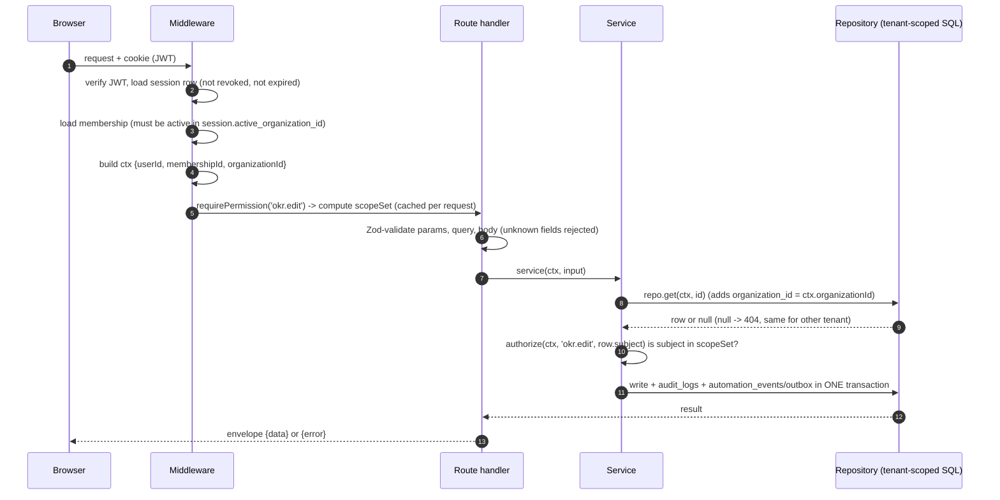

# Zentro: Permission Model

Covers master sections 3, 8.D, 15 and 20, plus showcase overrides 3 and 4. The hard requirements:

- Roles and permissions are **database rows**, never hardcoded assumptions about job titles.
- Access depends on **permission × scope**, and a title alone grants nothing.
- Tenant isolation without Row Level Security (SQLite has none): one data-access layer, organization id from the **server-side session only**, plus automated proof.
- Authorization happens **before** data is retrieved (also for AI), not by filtering afterwards.

Related: [database-design](database-design.md) (tables), [api-documentation](api-documentation.md) (permission per route), [agent-specifications](agent-specifications.md) (agents run as the asking user).

---

## 1. Concepts

| Concept | Definition |
| --- | --- |
| **Person** | `organization_memberships.id`, a person inside one organization. A user (login) can have memberships in several organizations. |
| **Permission** | A global, code-referenced key such as `okr.edit`. The catalog is seeded by migration (section 2). |
| **Role** | An organization-owned row: a named bundle of `(permission, scope_mode)` pairs. Seeded from templates at organization creation, then fully editable. |
| **Assignment** | `user_role_assignments`: gives a person a role **within a scope** (`organization`, `department`, `team`, or `self`), optionally time-bound. A person can hold several assignments (Team Lead of A, Mentor, Employee). |
| **Scope mode** | How far a permission reaches around the person: `own`, `my_teams`, `reports`, `all_in_scope`. |
| **Assignment scope** | The upper bound where the role applies (the whole organization, one department subtree, one team subtree). |
| **Scope set** | The resolved result for one permission: which people, teams and departments the caller may act on. |

### 1.1 The one rule

For permission `P`, the caller's scope set is the union over their active assignments `A` of every role row `(P, S)`:

```
scopeSet(P) = ⋃ over assignments A, over role rows (P, S) of A.role :
                 modeSet(S, caller)  ∩  assignmentScope(A)
```

| Mode `S` | `modeSet(S, caller)` |
| --- | --- |
| `own` | the caller |
| `my_teams` | active members of every team the caller is an active member of |
| `reports` | the caller plus everyone below them in the reporting tree (active `primary` and `secondary` relationships; `dotted` and `project` count only if the organization turns that on in settings) |
| `all_in_scope` | everyone (then cut down by the assignment scope) |

| Assignment scope | `assignmentScope(A)` |
| --- | --- |
| `organization` | everyone in the organization |
| `department D` | active members of D and its child departments, and of all teams inside them |
| `team T` | active members of T and its sub-teams |
| `self` | the caller only |

"Active" means the effective-dated row covers the evaluation date (default: today). Historical reports (last quarter's scorecard) evaluate membership **as of that period's end**, so moving someone does not rewrite old visibility.

**Derived units.** A scope set also lists teams and departments, for resources whose subject is a team or department:

- `all_in_scope` with department/team scope: that unit subtree.
- `own` / `my_teams`: the teams the caller belongs to.
- `reports`: teams the caller belongs to, plus teams led (membership type `lead`) by the caller or any of their reports; departments headed by the caller or any of their reports.

**Worked examples** (all of these are data, none is code):

| Person | Assignment | Result |
| --- | --- | --- |
| Employee | Employee role @ organization | `okr.view`: own + `my_teams`; `performance.view_scores`: own only |
| Team lead of Platform | Team Lead role @ team Platform | team objectives and members' tasks for Platform and its sub-teams |
| Manager of three team leads | Manager role @ organization, `reports` modes | the three leads, everyone under them, and the teams those leads lead |
| Department head | Department Head role @ department Engineering | everyone and every team in Engineering's subtree |
| CEO | CEO role @ organization, `all_in_scope` | company-wide, including leadership reports |
| Someone who is both a Marketing manager and a Platform mentor | two assignments | union of both scope sets |
| Contractor with a 3-month grant | assignment with `valid_to` | access stops by itself on that date |

---

## 2. Permission catalog

Keys are stable identifiers used in code and in role editing. **Sensitive** means the permission exposes confidential material or changes access, so the UI warns when granting it and an audit row is always written. "Modes" lists the scope modes the role editor allows for that permission.

| Module | Key | Meaning | Modes | Sensitive |
| --- | --- | --- | --- | --- |
| Organization | `org.view` | See departments, teams, org chart | own, my_teams, reports, all_in_scope | |
| | `org.manage` | Create/rename/archive departments, teams, designations, role families | all_in_scope | |
| | `org.settings` | Organization settings (timezone, review cadence, defaults) | all_in_scope | yes |
| People | `people.view` | See people profiles (name, designation, team, manager) | own, my_teams, reports, all_in_scope | |
| | `people.manage` | Create, edit, move, archive people | reports, all_in_scope | |
| | `people.view_sensitive` | Employment details (start date, type, employee code) | own, reports, all_in_scope | yes |
| | `hierarchy.manage` | Change reporting relationships, team and department membership | reports, all_in_scope | |
| | `invitations.manage` | Create and revoke invitations | all_in_scope | |
| Access | `roles.view` | See roles and who holds them | all_in_scope | |
| | `roles.manage` | Edit roles, permissions, assignments | all_in_scope | yes |
| | `audit.view` | Read the audit log | all_in_scope | yes |
| OKRs | `okr.view` | See objectives and key results | own, my_teams, reports, all_in_scope | |
| | `okr.create` | Create objectives and key results | own, my_teams, reports, all_in_scope | |
| | `okr.edit` | Edit objectives and key results | own, my_teams, reports, all_in_scope | |
| | `okr.archive` | Archive/cancel objectives | reports, all_in_scope | |
| | `okr.assign` | Assign owners and link parents | my_teams, reports, all_in_scope | |
| | `okr.update_progress` | Record actual key-result values | own, my_teams, reports, all_in_scope | |
| | `okr.publish` | Publish an objective for organization-wide visibility (leadership objectives) | all_in_scope | |
| KPIs | `kpi.view` | See KPI definitions, targets, measurements | own, my_teams, reports, all_in_scope | |
| | `kpi.configure` | Create/edit KPIs, thresholds | all_in_scope | |
| | `kpi.assign` | Assign KPIs to roles, teams, people | my_teams, reports, all_in_scope | |
| | `kpi.record` | Record measurements (new rows, never overwrite) | own, my_teams, reports, all_in_scope | |
| Tasks | `task.view` | See tasks | own, my_teams, reports, all_in_scope | |
| | `task.create` | Create tasks | own, my_teams, reports, all_in_scope | |
| | `task.assign` | Assign or reassign tasks | my_teams, reports, all_in_scope | |
| | `task.edit` | Edit others' tasks | my_teams, reports, all_in_scope | |
| | `task.review` | Record outcome quality on completed tasks | my_teams, reports, all_in_scope | |
| Evidence | `evidence.view` | See evidence (not restricted) | own, my_teams, reports, all_in_scope | |
| | `evidence.submit` | Attach evidence | own, my_teams, reports, all_in_scope | |
| | `evidence.verify` | Mark evidence verified/rejected | my_teams, reports, all_in_scope | |
| | `evidence.view_restricted` | See `restricted` evidence | reports, all_in_scope | yes |
| Performance | `performance.view_scores` | See others' scorecards and totals | reports, all_in_scope | yes |
| | `performance.view_components` | See component breakdown and inputs | reports, all_in_scope | yes |
| | `performance.recalculate` | Trigger recalculation | reports, all_in_scope | |
| | `performance.configure` | Edit scoring models and weights | all_in_scope | yes |
| | `performance.manage_periods` | Open/close/lock periods | all_in_scope | |
| | `performance.compare` | Run peer/department comparisons | reports, all_in_scope | yes |
| | `reviews.write` | Write reviews for people in scope | reports, all_in_scope | |
| | `reviews.read_shared` | Read shared review summaries | reports, all_in_scope | |
| | `reviews.read_private` | Read private review notes | reports, all_in_scope | yes |
| Mentorship | `mentorship.view` | See assignments and effectiveness | own, my_teams, reports, all_in_scope | |
| | `mentorship.manage` | Create/end assignments | reports, all_in_scope | |
| | `mentorship.log` | Log activities and progress | own, reports, all_in_scope | |
| Leadership | `leadership.view` | Leadership dashboard and executive KPIs | all_in_scope | yes |
| AI | `ai.use` | Use the AI Intelligence Center chat | own, my_teams, reports, all_in_scope | |
| | `ai.view_insights` | See insights and risk alerts (visibility still follows subject scope) | own, my_teams, reports, all_in_scope | |
| | `ai.approve` | Approve AI proposals (must also hold the underlying action permission) | reports, all_in_scope | yes |
| | `ai.configure` | AI settings, agent enablement | all_in_scope | yes |
| Integrations | `integrations.view` | See connected apps and automation history | all_in_scope | |
| | `integrations.manage` | Embed token, connect apps, manage slots and rules | all_in_scope | yes |
| | `automations.retry` | Retry or cancel failed events | all_in_scope | |
| Operations | `system.view` | System panel (jobs, outbox backlog) | all_in_scope | |
| | `data.export` | Export organization data | all_in_scope | yes |
| | `demo.manage` | Load/remove demo data, view as demo persona | all_in_scope | yes |

### 2.1 Baseline self-service rights (not role-driven)

A small fixed set is **not** a permission, so no role edit can remove it. Master section 7.11 requires that people can see how their own score was calculated, and every person must be able to read their own record:

- read their own profile, own tasks, own objectives and key results, own KPI measurements;
- read their **own** score, its components and the inputs behind them, and the shared parts of their own reviews;
- read their own notifications and manage their own preferences and password;
- read objectives that are `published` with `organization` visibility (leadership objectives), read-only.

Everything beyond this comes from a role. These rights never reach other people's data and never include `private_notes`.

---

## 3. Role templates (seeded per organization, then editable)

Seeded when an organization is created so it is usable immediately. Nothing in code looks at a role's `key` or `name` (a test greps for role names in `backend/src` and fails if it finds any). The table shows each template's modes: **O**=own, **T**=my_teams, **R**=reports, **S**=all_in_scope, a dash = no grant. Assignment scope noted per row.

| Permission group | Owner | CEO | Senior Mgmt | Dept Head | Manager | Team Lead | Mentor / TLC | Employee | Intern |
| --- | --- | --- | --- | --- | --- | --- | --- | --- | --- |
| Default assignment scope | organization | organization | organization | department | organization | team | organization | organization | organization |
| `org.view`, `people.view` | S | S | S | S | R+T | R+T | T | T | T |
| `org.manage`, `hierarchy.manage` | S | S | | S | | | | | |
| `people.manage` | S | S | | S | R | | | | |
| `people.view_sensitive` | S | S | | S | R | | | O | O |
| `invitations.manage` | S | S | | S | | | | | |
| `roles.view` / `roles.manage` | S / S | S / | | | | | | | |
| `org.settings`, `audit.view`, `data.export`, `demo.manage` | S | | | | | | | | |
| `okr.view` | S | S | S | S | R+T | R+T | T | O+T | O+T |
| `okr.create`, `okr.edit`, `okr.assign` | S | S | S | S | R | R | O | O | |
| `okr.update_progress` | S | S | S | S | R | R | O | O | O |
| `okr.publish` | S | S | | | | | | | |
| `kpi.view` | S | S | S | S | R+T | R+T | T | O+T | O |
| `kpi.configure` | S | S | | S | | | | | |
| `kpi.assign` | S | S | | S | R | R | | | |
| `kpi.record` | S | S | S | S | R | R | O | O | O |
| `task.view` | S | S | S | S | R | R | T | O+T | O+T |
| `task.create`, `task.assign`, `task.edit` | S | | | S | R | R | O | O (create/edit own) | O (create/edit own) |
| `task.review` | S | | | S | R | R | R | | |
| `evidence.submit` | S | S | S | S | R | R | O | O | O |
| `evidence.verify` | S | | | S | R | R | R | | |
| `evidence.view` | S | S | S | S | R | R | T | O | O |
| `evidence.view_restricted` | S | | | S | R | | | | |
| `performance.view_scores`, `.view_components` | S | S | S | S | R | R | R (mentees) | | |
| `performance.compare` | S | S | | S | R | | | | |
| `performance.configure`, `.manage_periods` | S | | | | | | | | |
| `performance.recalculate` | S | | | S | R | | | | |
| `reviews.write` / `.read_shared` | S | S | S | S | R | R | R | | |
| `reviews.read_private` | S | | | | | | | | |
| `mentorship.view` | S | S | S | S | R | R | O | O | O |
| `mentorship.manage` / `.log` | S | | | S | R | R | O (log) | | |
| `leadership.view` | S | S | S | | | | | | |
| `ai.use`, `ai.view_insights` | S | S | S | S | R | R | T | O | O |
| `ai.approve` | S | S | | S | R | R | | | |
| `ai.configure` | S | | | | | | | | |
| `integrations.view`, `automations.retry`, `system.view` | S | | | | | | | | |
| `integrations.manage` | S | | | | | | | | |

Notes:

- The CEO has **no daily-task grants** (`task.create/assign/edit` are not given) and a different scoring model; see [scoring-architecture](scoring-architecture.md).
- The matrix is a starting point. A CEO who should not see restricted evidence, a team lead who should see scores, or a brand-new "Program Director" role are all done in **Settings → Roles** with no code change.
- **Super Admin** in master section 15 is a platform operator. The showcase has no cross-tenant operator console, so `users.is_platform_admin` is reserved and grants nothing in tenant data. The **Organization Owner** is the highest role inside an organization.

---

## 4. Enforcement: five layers



| Layer | Guarantee | Verified by |
| --- | --- | --- |
| 1. Session | Only a live, unrevoked session yields a `ctx`; the active organization comes from the session row, and the membership must still be active (so removing someone ends their access on the next request). | auth tests, revocation test |
| 2. Route guard | `requirePermission(key)` rejects (403) if the caller's scope set for `key` is empty. A route cannot be mounted without declaring its permission (registry check at boot, a test enumerates routes). | permission matrix |
| 3. Repository | Every function takes `ctx`; every statement on an organization-owned table includes `organization_id = ?` from `ctx`. Lists take the scope set and compile it into the `WHERE` clause, so counts and pagination are already correct and nothing is filtered after the fact. | SQL-lint test, tenancy matrix |
| 4. Object check | Single-record operations authorize the **record's subject** (person/team/department) against the scope set after loading it. Unknown or other-tenant ids return **404**, never 403. | permission and tenancy matrices |
| 5. Strict mode in tests | With `ZENTRO_STRICT_TENANT=1` the repository wrapper asserts that **every returned row** has `organization_id === ctx.organizationId`, catching a missing predicate in a join. | enabled in the whole API test suite |

**List endpoints compile scope to SQL.** For a person-subject table the predicate is `subject_membership_id IN (…ids…)` (or none for organization-wide). With at most a few hundred people this is fine for SQLite (placeholder limit 32,766); a Postgres port would use `= ANY($1)`. For team or department subjects the predicate uses the derived unit ids.

**Resolver performance.** The scope set is computed with recursive CTEs over `reporting_relationships`, `team_memberships` and `department_memberships`, memoized per request and cached in memory keyed by `(organizationId, membershipId, hierarchyVersion)`. `hierarchyVersion` is an in-memory counter bumped inside the transaction that changes reporting, team/department membership or role assignments. The app is one process, so there is no cross-process staleness; a 60-second TTL is a second safety net.

---

## 5. Visibility rules for confidential data

| Data | Rule |
| --- | --- |
| Review `private_notes` | Only `reviews.read_private` within scope. Never returned to the subject, never given to the AI. |
| Review `shared_summary`, rating | Subject sees it once the review is `submitted` and visibility is `subject_visible`; others need `reviews.read_shared` in scope. |
| Scores and component inputs | Others: `performance.view_scores` / `.view_components` in scope. The subject always sees their own (baseline). Peer comparisons show **no names** to people without `performance.compare`; the person sees only their own position in a cohort. |
| Evidence | `organization` visibility: anyone with `evidence.view` in scope; `scope`: same plus the submitter; `restricted`: `evidence.view_restricted` only. Files are served by an authenticated route that re-runs this check. |
| Employment details | `people.view_sensitive`; own record always. |
| Leadership objectives | An objective with `visibility = organization` **and** `published_at` set is readable by every active member (read-only). Draft and `private` objectives are not. Employees therefore see CEO strategic goals and their progress, but not confidential notes or the CEO's private reviews. |
| Audit log | `audit.view` only. |
| AI insights | A listed insight is shown only if the viewer's scope covers its subject; each insight stores its subject for this check. |

---

## 6. Guardrails against privilege escalation and lockout

1. **Cannot grant what you do not hold.** A caller with `roles.manage` may only create or edit roles whose permissions (and modes) are within their own effective permissions, unless they hold the Owner template's full set.
2. **Last administrator protected.** The service refuses any change that would leave the organization with nobody holding `roles.manage` + `org.settings` at `all_in_scope`.
3. **No self-approval of high-risk AI actions.** `ai.approve` is required, and the approver must also hold the permission for the underlying action within scope. For `risk_level = high` the approver must differ from the requester (organization setting, default on).
4. **AI cannot exceed the user.** Agents run as the asking user: tool calls use that user's `ctx` and scope set. An agent has no tool that writes directly.
5. **Time-bound and revocable.** Assignments carry `valid_from`/`valid_to`; revocation sets `revoked_at` and bumps `hierarchyVersion`, so the next request is already denied.
6. **Role editing is audited** with before/after of the permission set.
7. **View as demo persona** (admin, `demo.manage`): issues a **read-only** session for an `is_demo` user (writes rejected by `ctx.readOnly`), shows a persistent banner, and writes an `impersonation` audit row. It cannot target real users. This is what lets one presenter show the employee, manager and CEO views on the live link. (Open question 6 in my report asks whether to build it.)

---

## 7. Multi-tenant model without RLS

SQLite has no Row Level Security. The replacement is layered and tested rather than clever:

- **One data-access layer.** SQL exists only in `modules/*/repositories`. A test fails the build if `db.prepare`, `db.exec` or raw SQL strings appear elsewhere.
- **Organization id from the session only.** Routes never read an organization id from a body, query or path to decide tenancy; entity ids in URLs are resolved **inside** the caller's organization.
- **SQL lint test.** Parses every repository statement; any statement touching an organization-owned table without an `organization_id` predicate fails, except an allow-list (`permissions`, `schema_migrations`, auth tables keyed by `user_id`).
- **Tenancy matrix test (generated).** Two fixture organizations with identical shapes. For every registered route that takes an entity id: log in as org B, call it with org A's ids → expect **404**; lists never contain org A rows; writes never alter org A (checked by hashing org A's tables before and after).
- **Cross-reference test.** Creating a task in org B that references org A's objective, team or person is rejected.
- **Strict mode** (layer 5 above) turns any leak into a failing test.
- **Recorded in [risks](risks.md) R-01:** this is application-level isolation. A single missed predicate is a leak, which RLS would have contained. Postgres plus RLS remains the production path.

---

## 8. Authentication and session flows

| Flow | Behavior |
| --- | --- |
| Register | Email + password (≥10 chars). Subject to `REGISTRATION_MODE` (`open`, `invite_only`, `code`). Creates a `users` row only. |
| Create organization | Creates `organizations`, the creator's membership, seeded roles from templates, default designations and scoring models, and assigns the creator **Owner @ organization**. All in one transaction. |
| Login | Verify scrypt hash (constant-time), rate-limited per IP and per account. Creates a `sessions` row. If the user has several memberships, the session's `active_organization_id` is the last used, or the user picks one. |
| Switch organization | `POST /api/auth/switch-organization` with a membership the user actually holds; updates the session row. |
| Logout | Revokes the session row; cookie cleared. |
| Invitation | Admin creates a membership (person on the org chart before they have a login) and an invitation. The code/link is shown **once** to the admin and, if the platform email flow is configured, emailed. The invitee registers or logs in and accepts; the membership binds to their user. Expiry 7 days; revocable. |
| Password reset | Token (hash stored, 1 hour, single use). Emailed if the platform email flow exists; otherwise an administrator generates a reset link for a member and copies it (the Curevia fallback). Reset revokes all the user's sessions. |
| Email verification | Optional (master: "where supported"). On when the platform email flow exists; unverified users can log in but cannot accept an invitation until verified when `REQUIRE_VERIFIED_EMAIL=true`. |
| Session expiry | Sliding 7 days, absolute 30 days (configurable). Expired session rows purged by the housekeeping job. |
| Cookie | `zentro_session`: JWT HS256 `{sub, sid, iat, exp}`, `httpOnly`, `SameSite=Lax`, `Secure` in production, path `/`. |
| CSRF | Non-GET requests must carry a matching `Origin`/`Referer` and JSON content type. |

---

## 9. Permission test plan

| Test | Cases |
| --- | --- |
| Catalog integrity | Every permission key referenced in code exists in the seeded catalog and vice versa; every route declares one. |
| Scope resolution | Table-driven: reports closure at depth 3, dotted excluded by default and included by setting, effective dating (moved person), team subtree, department subtree, time-bound assignment expiry, union of two assignments. |
| Permission matrix | Employee, intern, mentor, team lead, manager, department head, CEO, owner × every route: expected 200/403/404, verified against the role template table above. |
| Baseline rights | An employee whose role has **no** grants still reads own score and components, and cannot read a peer's. |
| Confidential data | `private_notes` absent from subject's and manager-without-permission's response; restricted evidence file download denied (403 → 404 for out-of-scope); leadership objective visible to all, draft not. |
| Escalation | Role editor cannot grant a permission they lack; last-admin removal refused; self-approval refused for high risk. |
| AI parity | Same question as employee vs manager: tool results differ by scope and contain no out-of-scope ids (see [agent-specifications](agent-specifications.md)). |
| Revocation | Removing a membership or role assignment denies the very next request from an existing session. |
| No title logic | Greps `backend/src` for role template names. |
