# Zentro: Scoring Architecture

Covers master sections 7, 8, 9, 20 and 22. The rule that governs everything here: **every number is computed by deterministic backend code from stored inputs, and every number can be explained and reproduced.** The LLM never calculates a score; it narrates the structured explanation this engine produces ([agent-specifications](agent-specifications.md)).

Illustrative defaults in this document (weights, minimums, bands, factors) are **configurable starting points, not universal rules** (master section 7). They are stored as data in `scoring_models` and `scoring_model_components` and edited under Settings → Performance scoring.

Related: [database-design](database-design.md) section 3.7, [permission-model](permission-model.md) (who may see scores), [api-documentation](api-documentation.md) (performance routes).

---

## 1. Architecture

```mermaid
flowchart LR
  subgraph DB["SQLite (read-only for the engine run)"]
    KR[key_results + objectives]
    KM[kpi_measurements]
    TK[tasks + task_updates]
    EV[evidence + evidence_links]
    MS[mentorship_*]
    HR[reporting / team / designation history]
  end
  COL["Input collector<br/>(backend/scoring/collector.ts)<br/>reads rows as of period end"]
  SNAP["ScoreInputs snapshot<br/>(plain JSON, canonicalized)"]
  ENG["computeScore(inputs, model)<br/>PURE function:<br/>no DB, no clock, no AI, no randomness"]
  RES["ScoreResult<br/>total, status, confidence,<br/>components, explanation"]
  STORE["performance_scores (immutable run)<br/>performance_score_components<br/>(inputs_json = exact records used)"]
  DB --> COL --> SNAP --> ENG --> RES --> STORE
  MODEL["scoring_models + components<br/>(versioned data)"] --> ENG
  STORE --> UI["Scorecard UI: 'How was this calculated?'"]
  STORE --> AGENT["Performance Analysis agent<br/>(narrates, never recalculates)"]
```



Three separated responsibilities:

| Part | Does | Must not |
| --- | --- | --- |
| **Collector** (`scoring/collector.ts`) | Reads the database and produces a `ScoreInputs` snapshot for one subject and period, evaluating organizational membership **as of the period end**. | Compute scores. |
| **Engine** (`scoring/engine.ts`, `providers/*.ts`) | `computeScore(inputs, model, engineVersion) → ScoreResult`. | Touch the DB, call `Date.now()`, `Math.random()`, the network or an LLM. A lint rule and an import-boundary test (`scoring/` may import only `shared/` and its own files) enforce this. |
| **Runner** (`modules/performance/service.ts`) | Collects, hashes, runs the engine, stores a new immutable run only if the input hash changed, writes audit rows. | Edit a stored run. |

`inputs_hash = sha256(canonicalJson({inputs, modelVersionSnapshot, engineVersion}))`. If the latest stored run has the same hash, recalculation is a no-op. Otherwise run number `n+1` is inserted; earlier runs stay forever, which gives the score-change history for free (master section 22).

---

## 2. Component providers

A scoring model is a list of `(component_key, weight, provider_key, min_sample, config)` rows. **Providers are code; weights and thresholds are data.** A provider reads only the snapshot and returns:

```ts
interface ProviderResult {
  value: number | null;        // normalized 0-100, or null if it cannot be computed
  state: 'ok' | 'insufficient' | 'missing';
  sampleSize: number;          // records that contributed (key results, measurements, tasks...)
  coverage: number;            // 0-1: share of the expected records that exist
  evidenceShare: number;       // 0-1: contributing records with at least one VERIFIED evidence link
  contributors: Contributor[]; // {ref:{type,id}, label, value, target?, weight, note?}
  notes: string[];             // data-quality notes shown to the user
}
```

| Provider key | Used by | What it measures |
| --- | --- | --- |
| `okr.attainment` | individual | Weighted key-result attainment of the person's objectives in the period (section 3.1) |
| `okr.team_attainment` | team lead, manager | Same, for the team objectives the person owns or leads |
| `okr.department_attainment` | department head | Department objectives |
| `okr.company_attainment` | CEO, senior mgmt | Company objectives owned by or assigned to the person |
| `kpi.attainment` | all | Attainment of KPIs assigned to the subject (section 3.2) |
| `kpi.attainment.executive` | CEO, senior mgmt | Same, restricted to KPIs in executive categories |
| `tasks.delivery` | individual, intern, mentor | On-time, importance-weighted delivery and estimate accuracy (section 3.3) |
| `team.delivery` | team lead, manager | `tasks.delivery` over the team's tasks (rates, not counts) |
| `quality.impact` | individual, team lead | Quality/impact KPIs plus reviewer-rated task outcomes (section 3.4) |
| `team.development` | team lead, manager | Improvement of members' scores and blocker resolution |
| `mgmt.responsibilities` | manager | Reviews submitted on time, 1:1 cadence, blocker resolution time |
| `mentorship.development` | mentor | Measured mentee improvement (section 7) |
| `mentorship.activity` | mentor | Cadence adherence of logged mentoring activities |
| `dept.team_performance` | department head | Median and spread of team scorecards in the department |
| `dept.contribution` | department head, senior mgmt | Contribution to company objectives via alignment links (section 8) |
| `leadership.strategic_execution` | CEO, senior mgmt | Attainment **and pace** of strategic objectives (section 8) |
| `org.health` | CEO | Participation and median of department scores, plus configured health KPIs |

New providers can be added in code later; they appear in the model editor automatically.

---

## 3. Normalization rules (each provider's math)

All intermediate values keep full floating-point precision. Rounding happens once, at the end (section 5.3).

### 3.1 Key results and objectives (OKR achievement)

A key result's **attainment** `a` (0 to 1) is computed from stored values only:

| Measurement | Formula |
| --- | --- |
| Increase (default): percentage, number, currency, count, custom | `a = (current − start) / (target − start)` |
| Decrease (e.g. cost, defects) | `a = (start − current) / (start − target)` |
| Boolean | `a = current` (0 or 1) |
| Manual / milestone method | `a = current / 100` (the owner records a percentage) |

Then `a = clamp(a, 0, cap)`. `cap` is a model setting, **default 1.0** (no credit above 100%); an organization may set 1.2 to allow limited stretch credit. A regression (`a < 0`) is floored at 0 and flagged "regressed" in the notes. `target = start` is rejected when the key result is created; if it ever occurs, `a = current ≥ target ? 1 : 0` with a data-quality note.

- `current_value IS NULL` → the key result has **no data** (not zero).
- **Objective attainment** = `Σ(weight_k · a_k) / Σ(weight_k)` over key results **that have data**. The objective's data state is `ok` if at least 50% of its key-result weight has data (`min_kr_weight_with_data`, configurable), else `insufficient`.
- **OKR component** for a subject = weighted mean of objective attainments (objective `weight`) for objectives that **overlap the period** and have lifecycle `active` or `completed` (drafts and cancelled excluded).
- Tasks never enter this component. **A completed task does not make a key result succeed; the recorded actual value does.** (Master section 4: "An objective must not be considered successful merely because all associated tasks are marked complete.")

Roll-up between levels (optional per objective, `rollup_mode`): `own` (default: its own key results), `children` (weighted by `objective_relationships.contribution_weight`), or `blended` (50/50).

### 3.2 KPIs

For each active assignment of a KPI to the subject (direct, or via their designation/role family/team/department):

1. Take the period's **current** measurements (those no later row supersedes), ignoring `value_status = disputed`.
2. Aggregate by the KPI's `aggregation` (sum, avg, last, min, max) → `v`.
3. Attainment against the assignment target `T`:

| KPI direction | `a` |
| --- | --- |
| `higher_is_better` | `min(v / T, cap)` (T > 0) |
| `lower_is_better` | `v = 0 ? cap : min(T / v, cap)` |
| `target_range` (`T` to `T_max`) | in range → 1; outside → `max(0, 1 − distance / (T_max − T))` |

4. **Coverage** = measurements present ÷ measurements expected for the period and KPI frequency (e.g. 3 monthly measurements in a quarter). No measurements → `missing`. Coverage below `min_measurement_coverage` (default 0.5) → `insufficient` (shown, but excluded from the score). Otherwise `ok`, and coverage lowers confidence (section 5.2).

The KPI component is the weighted mean of the `ok` assignments' attainments (`kpi_assignments.weight`).

### 3.3 Delivery and reliability (`tasks.delivery`)

Population: tasks **due within the period**, with an active assignment to the subject (or the team for the team variant), excluding cancelled tasks. Tasks not yet due and not complete are *pending* and excluded.

Per task `i` with weight `w_i = importance_weight × priority_factor` (low 0.5, medium 1, high 1.5, critical 2):

| Situation | Credit `c_i` |
| --- | --- |
| Completed on or before `due_at` | 1 |
| Completed late by `d` days | `0.5 × max(0, 1 − d / late_decay_days)` (default `late_decay_days = 7`) |
| Overdue and not completed | 0 |

`on_time = Σ(w_i · c_i) / Σ(w_i)`. If at least `min_estimate_pairs` completed tasks have both estimated and actual minutes, **estimate accuracy** `= mean(min(est, act) / max(est, act))` is blended in at `estimate_weight` (default 0.2). Blocked time caused by others is **not** penalized (it is shown as a note).

Sample rule: fewer than `min_sample` (default 5) due tasks → `insufficient`. **Because the provider is built from weighted rates, doing 100 on-time tasks and 20 on-time tasks gives the same delivery value.** Quantity alone cannot raise a score (master section 7 rule 7). The weighted task load appears as *context* in comparisons, not as a score input.

### 3.4 Quality and business impact (`quality.impact`)

Two inputs, blended by `quality_blend` (default 50/50; if only one exists it is used and the note says so):

1. Attainment of the subject's KPIs whose category is `quality` or `impact` (same math as 3.2).
2. **Reviewer-rated task outcome quality**: mean of `(outcome_quality − 1) / 4 × 100` over completed tasks with a rating, weighted by `w_i`. At least `min_rated_tasks` (default 3).

### 3.5 Evidence and the score

Missing evidence does **not** zero a score (master section 7 rule 8). Evidence changes **confidence**, not the value:

- `evidenceShare` = weight-share of contributing records (key-result updates, KPI measurements, completed tasks with outcomes) that have at least one `verified` evidence link.
- Each component has `evidence_expectation`: `none`, `recommended` (default) or `required`. With `required`, unverified records still count at full value but the component is flagged "claims not yet evidenced" and confidence drops. An organization that wants stricter treatment can set `unverified_credit` below 1 (default 1.0).
- Integration events are stored as unverified evidence and never count as verified until a person verifies them (master section 12).

---

## 4. Role-specific models (seeded templates, all editable)

Different roles use different models (master section 7 rules 1 to 6). These are **data** seeded from `backend/scoring/templates.ts` when an organization is created; admins can change weights, minimums, even the component list.

| Template | Components (weight) | Notes |
| --- | --- | --- |
| **Employee** (the illustrative default) | OKR achievement 40 (`okr.attainment`), KPI achievement 30 (`kpi.attainment`), Delivery and reliability 15 (`tasks.delivery`), Quality and business impact 15 (`quality.impact`) | Matches the master example: 85, 90, 80, 90 → **86.5** |
| **Intern** | OKR 30, KPI 15, Delivery 25, Quality 15, Growth 15 (`mentorship.development` on the intern as mentee: own improvement) | Emphasizes learning and reliability |
| **Team lead** | Team outcomes 35 (`okr.team_attainment` + team KPIs), Own OKR and KPI 20, Team delivery reliability 15 (`team.delivery`), Team development 15 (`team.development`), Quality of team output 15 (`quality.impact` on team) | Master KPIs: team objective achievement, delivery reliability, employee development, output quality, blocker resolution |
| **Manager** | Team and project outcomes 40, Management responsibilities 20 (`mgmt.responsibilities`), Own objectives 15, Delivery and budget adherence 15, Team development 10 | Evaluated on team outcomes and management duties, not on personal task volume |
| **Mentor / TLC** | Own OKR 20, Own KPI 15, Delivery 15, Mentee development 35 (`mentorship.development`), Mentoring activity 15 (`mentorship.activity`) | "Evaluated partly on measurable team development" |
| **Department head** | Department objectives 35, Department KPIs 20, Team performance 15 (`dept.team_performance`), Productivity and budget efficiency 15 (financial/health KPIs), Strategic contribution 15 (`dept.contribution`) | |
| **Senior management** | Strategic initiative execution 40, Executive KPIs 30, Cross-department contribution 15, Organizational health 15 | |
| **CEO** | Company OKR achievement 40 (`okr.company_attainment`), Executive KPIs 30 (revenue growth, profitability, retention, customer growth), Strategic execution and pace 15 (`leadership.strategic_execution`), Organizational health 15 (`org.health`) | **No task-based component** (master section 7 rule 3) |

A model applies to a subject by `role_family_id` / `designation_id` (most specific wins) with an organization default. A person's applicable model is resolved **as of the period end** via `designation_assignments`.

Model management rules: weights of an active model sum to exactly 100; editing creates version `n+1` (old versions stay `retired`, scores keep pointing at the version they used); a **what-if preview** runs the engine in dry-run mode on a chosen person and period, storing nothing; changing a model never rewrites history. Recalculating a past period under a new model is an explicit admin action that inserts new runs next to the old ones.

---

## 5. Combining components: weights, missing data, status

### 5.1 Missing-data rules (the heart of master sections 5, 7, 20.7)

Each component ends in exactly one **data state**:

| State | Meaning | In the score? | Shown as |
| --- | --- | --- | --- |
| `ok` | Enough data (sample and coverage at or above the model minimums) | Yes | the value |
| `insufficient` | Some data, below the minimum | **No**, but the value is displayed | "Not enough data (2 of 5 needed)" |
| `missing` | No data at all | **No** | "No data recorded" |

**A recorded zero is a real zero; no record is not zero.** Example: a KPI measured at 0 against a target of 10 has attainment 0 and pulls the score down; a KPI with no measurement at all is excluded and listed as missing.

Weights of the components that are `ok` are **renormalized** so they sum to 1:

```
W = Σ weight_i of ok components, divided by Σ weight_i of all components      (weight coverage, 0..1)
effective_weight_i = weight_i / (Σ weight_j over ok components)
total = Σ effective_weight_i × normalized_score_i
```

### 5.2 Status and confidence

| Status | Condition |
| --- | --- |
| `insufficient` | `W < min_weight_coverage` (default 0.60), or no `ok` component → **`total_score` is null**, the UI says "Not enough data to score", and lists exactly what is missing |
| `provisional` | Score computed, but at least one reason applies: the period is still **open**, a component is missing/insufficient, confidence below `min_confidence_for_final` (default 0.6), or a model-required component lacks evidence. The reasons are listed. |
| `final` | Period is **closed** (or locked), `W = 1` (all components `ok`), and confidence ≥ `min_confidence_for_final` |

```
confidence = W × sample_factor × evidence_factor
sample_factor   = mean over ok components of min(1, sampleSize / (2 × min_sample))
evidence_factor = 0.5 + 0.5 × weighted mean of evidenceShare       (never below 0.5)
label: ≥ 0.80 high, ≥ 0.50 medium, else low
```

So absent evidence lowers *confidence* to as little as half, and never the score itself.

### 5.3 Rounding and determinism

- Iteration order is fixed (components sorted by `sort_order`, then key); no parallel accumulation.
- Internal values are IEEE doubles, full precision, serialized to canonical JSON with up to 12 significant digits for hashing.
- `total` is rounded **half-up to 1 decimal** once, using integer arithmetic on `x × 10` with an epsilon guard, so 86.45 → 86.5 on every platform. Components display rounded to 1 decimal; a "rounding" line explains if displayed parts differ from the total by 0.1.
- Advisory **bands** (default: ≥ 90 Exceeding, 75 to < 90 On target, 60 to < 75 Developing, < 60 Needs attention) are labels on the number, configurable, never actions.

### 5.4 Worked examples (these become golden tests)

Model: OKR 40, KPI 30, Delivery 15, Quality 15.

| Case | Inputs | Result |
| --- | --- | --- |
| **A. All present** | OKR 85, KPI 90, Delivery 80, Quality 90 | `85×0.40 + 90×0.30 + 80×0.15 + 90×0.15 = 34 + 27 + 12 + 13.5 = ` **86.5**, `W = 1`, closed period → `final` |
| **B. KPI missing** | OKR 85, KPI *missing*, Delivery 80, Quality 90 | `W = 0.70`; `(34 + 12 + 13.5) / 0.70 = ` **85.0**, `provisional` (reason: KPI missing), coverage shown as 70% |
| **C. Too little data** | only Quality 90 ok | `W = 0.15 < 0.60` → **`insufficient`**, `total_score` null |
| **D. Zero vs missing** | KPI measured 0 vs target 10 | attainment 0, included: OKR 85, KPI 0, Delivery 80, Quality 90 → `34 + 0 + 12 + 13.5 = ` **59.5**, `final` if period closed. Same person with **no** KPI measurement → case B (85.0 provisional). |
| **E. Quantity is irrelevant** | 20 tasks all on time vs 100 tasks all on time | identical `tasks.delivery`; only `sample_factor` (confidence) can differ |
| **F. CEO** | OKR 70, Exec KPI 80, Strategic pace 60, Org health 75 with 40/30/15/15 | `28 + 24 + 9 + 11.25 = ` **72.25 → 72.3** (half-up) |

---

## 6. Explanation (deterministic, always available)

Every score run stores `explanation_json`, produced by code with fixed templates (so it exists even when no AI is configured):

```jsonc
{
  "formula": "(85.0 × 0.40) + (90.0 × 0.30) + (80.0 × 0.15) + (90.0 × 0.15) = 86.5",
  "status": "final",
  "confidence": { "value": 0.86, "label": "high", "parts": { "coverage": 1.0, "sample": 0.93, "evidence": 0.92 } },
  "components": [
    { "key": "okr", "label": "OKR achievement", "state": "ok", "score": 85.0, "weight": 0.40,
      "points": 34.0, "topContributors": [ { "ref": {"type":"key_result","id":"…"}, "label": "Generate 100 qualified leads", "attainment": 0.92 } ],
      "gaps": [ { "ref": {"type":"key_result","id":"…"}, "label": "22% conversion rate", "attainment": 0.64 } ] }
  ],
  "dataQuality": [ "KPI 'Lead quality score' has 1 of 3 expected monthly measurements" ],
  "whatWouldChangeThis": [ "Record the 2 missing monthly measurements for 'Lead quality score'" ]
}
```

- Users see this under **"How was this calculated?"** with links to each contributing record (filtered by their own permissions, [permission-model](permission-model.md) section 5).
- A **verify** action (`POST /api/performance/scores/:id/verify`, permission `performance.view_components`) recomputes the stored inputs with the stored model version and engine version and reports whether the total matches: a visible proof of reproducibility (master section 20.4).
- The Performance Analysis agent receives this JSON as tool output and may only restate and interpret it; its numbers are checked against it ([agent-specifications](agent-specifications.md) section 4).
- **No automated employment decisions.** The product shows scores as information. No endpoint, export, notification or agent output recommends hiring, firing, promotion or compensation; an output filter on agent text blocks such recommendations, and the UI carries a standing notice (master section 7).

---

## 7. Mentorship and TLC effectiveness

Measures **development of assigned mentees over time**, without attributing every outcome to the mentor (master section 8.C).

For each mentorship assignment `e` (mentor `m`, mentee `x`) overlapping period `P`:

1. **Overlap and duration factor:** `overlap_days` = days the assignment is active within `P`; `duration_factor = min(1, overlap_days / min_days)` (default `min_days = 60`).
2. **Baseline:** the mentee's last score before the assignment started (or the first score inside it if none), only if comparable (same role family, status at least provisional).
3. **Measured deltas** (stored in `mentorship_progress`, source `computed` unless entered by a person):

| Metric | Computation |
| --- | --- |
| `score_delta` | mentee total score now − baseline (points) |
| `delivery_delta` | change in `tasks.delivery` |
| `quality_delta` | change in reviewer-rated outcome quality |
| `blocker_resolution_days` | median days from a `blocker` task update to the next non-blocked status, vs baseline |
| `goal_achievement` | attainment of the mentee's objectives with type `development` |

4. **Improvement index per mentee:** `imp_x = clamp(50 + k × mean(normalized deltas), 0, 100)` with `k` default 2.5 points per delta point, so 50 means "no change" and +20 delta points reaches 100. `k` and the metric mix are model config.
5. **Credit split:** `share_x = 1 / (number of active mentors of x in P)`.
6. **Mentor development component** = `Σ(duration_factor_x × share_x × imp_x) / Σ(duration_factor_x × share_x)` over mentees whose metrics are `ok`. Needs at least `min_sample` (default 2) such mentees, else `insufficient`.
7. **Mentoring activity component:** `min(1, activities_logged / (overlap_days / cadence_days))`, averaged over assignments, optionally blended with a mentee-entered rating (`skill_rating` rows).

**Factors disclosed, not silently adjusted:** assignment duration, number of mentors per mentee, mentee workload change, team change during the period, the mentor's mentee count (capacity), and cadence adherence. The UI states that mentee results have many causes. Mentors are compared only with mentors (same role family), with mentee count and duration shown beside the score.

---

## 8. Peer comparison and vertical accountability

### 8.1 Horizontal comparison (master section 8.A)

| Rule | Detail |
| --- | --- |
| **Cohort** | Same `role_family`, same period, same subject type. Membership in a family is resolved **as of the period** through `designation_assignments`. Optional filters: seniority band, minimum tenure in role (default 30 days), department. |
| **No cross-role scoring** | Comparing different role families is refused (`422 cohort_mismatch`). No "universal" score exists to compare a PM with an engineer. |
| **Which scores** | `final` and `provisional` scores of the same model family; `insufficient` are excluded (toggle to show them greyed). Components are compared only where both sides have the component. |
| **Normalization** | Cohort size ≥ 3: percentile rank (mid-rank) and rank among N. Cohort size ≥ 8: also z-score. Smaller cohort: raw side-by-side with "too few peers to rank". |
| **Context shown, not applied** | Tenure in role, weighted task load, team size, evidence confidence, data coverage, objective stretch hint. These are displayed next to the numbers; v1 does **not** adjust scores for them (known limitation), so the comparison is fair to read rather than falsely "corrected". |
| **Explaining differences** | `explainDifference(a, b)` is deterministic: per component, A's points minus B's points (a component with no data has no points), sorted by absolute contribution. The contributions add up to the difference between the two totals before rounding, which `(score_a − score_b) × effective_weight` does not when the two people's effective weights differ. The agent narrates this table. (Live, stage 5.4.) |
| **Who sees names** | Names and ranks need `performance.compare` in scope. Others see only their own percentile within their cohort. |
| **Snapshots** | A saved comparison stores its results in `performance_comparisons`, so it does not change under people's feet. |

Mentors compare with mentors, team leads with team leads, PMs with PMs, interns with interns. **Department comparison** uses department scorecards from the department model and states that departments differ in function ("compare attainment, not output volume").

### 8.2 Vertical accountability (master section 8.B and 9)

The alignment graph (`objective_relationships`: company → department → team → individual, with `contribution_weight`) gives a **contribution chain**:

- Each level shows its own attainment and its share of the parent's: `contribution_child = weight × attainment_child`.
- `dept.contribution` and `leadership.strategic_execution` use this chain, so a department head is measured by how much the department's objectives advanced the company's.
- **Pace:** `pace_ratio = attainment / elapsed_fraction` of the objective's window. Strategic execution blends attainment (70%) and pace-capped-at-1 (30%) by default.
- The leadership dashboard presents the chain as a waterfall from CEO objectives down to teams ([frontend-structure](frontend-structure.md)).

---

## 9. Objective health (on track / at risk / delayed)

A separate deterministic calculation (not a score) used by dashboards, notifications and the Risk agent:

```
elapsed = clamp((today − start) / (end − start), 0, 1)
ratio   = progress / elapsed                      (if elapsed < 0.05 use 'not_started'/'on_track' by data)
health  = completed        if progress ≥ 100 or lifecycle = completed
          delayed          if today > end and progress < 100
          on_track         if ratio ≥ 0.90
          at_risk          if 0.60 ≤ ratio < 0.90
          delayed          if ratio < 0.60
          no_data          if no key result has data and elapsed > 0.10
          not_started      if start is in the future
```

Thresholds (0.90 / 0.60 / 0.10) are organization settings. `health_reason` stores the numbers used, e.g. "progress 32% vs 55% expected (ratio 0.58)". Recomputed on every key-result update and by the hourly sweep; a transition to `at_risk` or `delayed` creates an `objective.at_risk` automation event (deduped per objective and status).

---

## 10. Periods, history and trends (master section 22)

- `performance_periods` are month, quarter, year or custom; `open → closed → locked`. Closing a period triggers a final recalculation run; `locked` forbids new measurements for it (corrections require a supersede with permission).
- The nightly `scores.recalculate` job recomputes **open** periods only; a new run is stored only if the input hash changed.
- Date-range filters (7 days, 30 days, this/last month, this/last quarter, this year, custom) map to periods or to ad-hoc windows. Ad-hoc windows compute **display-only** scores in dry-run mode (not stored).
- Period comparison (`GET /api/performance/trends`) returns per-component deltas across periods from stored runs.
- Organization, department and team history comes from scorecards with `subject_type` of `organization`, `department`, `team`, so leadership trends need no special tables.

---

## 11. Test plan

| Test | What it proves |
| --- | --- |
| Golden vectors A to F above | Exact totals, statuses, renormalization, half-up rounding |
| Property: monotonicity | Raising any key result's current value or KPI measurement never lowers the total |
| Property: weight scaling | Multiplying all weights by a constant gives the same total |
| Property: permutation | Reordering components or input records gives identical output and hash |
| Property: missing ≠ zero | Removing a measurement never lowers the score by treating it as 0; setting it to 0 does |
| Property: quantity invariance | Duplicating the set of on-time tasks leaves `tasks.delivery` unchanged |
| Reproducibility | Store a run, recompute from `inputs_json` with the stored model and engine version, totals equal |
| Purity | Import-boundary test on `scoring/`; calling `computeScore` twice gives deep-equal results |
| CEO model | No provider reading `tasks` is reachable from the CEO template (static check) |
| Period-end membership | A person who moved teams mid-quarter is scored and compared by their role at period end |
| Mentorship | Credit split with two mentors, duration factor below `min_days`, insufficient with one mentee |
| Comparison | `cohort_mismatch` refusal, small-cohort behavior, no names without `performance.compare` |
| Model editing | Sum ≠ 100 rejected on activate; editing creates a version; old scores keep their version |
