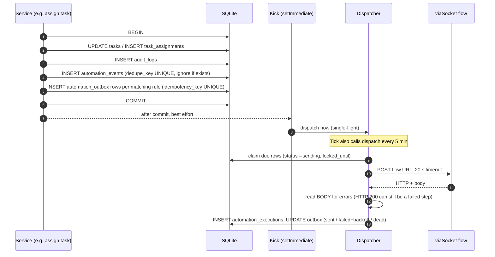

# Zentro: viaSocket Integration

Covers master section 14 and showcase override 7. viaSocket is the **automation and connectivity layer**, not the source of truth: Zentro's database holds the data; viaSocket delivers notifications and talks to other apps.

Related: [architecture](architecture.md) (tick and job model), [database-design](database-design.md) section 3.10, [permission-model](permission-model.md), [agent-specifications](agent-specifications.md) section 6 (approvals).

---

## 1. Do `ViaSocketActionEmbed` and `useGetViaSocketEmbedToken` exist?

**Short answer: I could not find either, anywhere I could read. Treat them as not existing until viaSocket shows otherwise.**

| Where I looked | Result |
| --- | --- |
| viaSocket's current agent guide `flow.viasocket.com/documentation/skill.md` (version 2026-11-20.6) and the pages it links: `viasocket.com/docs/embed.md`, `apps-api.md`, `skill/setup.md`, `skill/connect.md`, `skill/alerts.md`, `automations.md`, `ai.md`, `skill/app-integrations.md` | Neither name appears (searched every page). |
| npm package `viasocket-apps@0.21.0` (unpacked and searched; its exports are `.`, `./browser`, `./langchain`, `./ai-sdk`, `./openai-agents`) | Neither name appears. It is a server SDK plus a browser `connect()` helper, with no React components or hooks. |
| npm search for `viasocket`, `viasocket-embed`, `@viasocket/embed`, `viasocket-react` | No React embed package. |
| Your repos `Curevia` and `Automation_Embed` (HireDrive) | Neither name appears. Both use the script embed below. |
| Two web searches for the exact names | No result for either. |

**What I cannot rule out:** a private package, an unpublished or very recent component, or something shown only behind the viaSocket dashboard login ("Install Code"). I could not read anything behind a login, and I cannot prove a negative. If you saw these names somewhere specific, tell me where and I will check that source before stage 8.1.

**What actually exists and works (and is already proven in your two apps):**

| Piece | Reality |
| --- | --- |
| Embed script | `<script src="https://embed.viasocket.com/prod-embedcomponent.js">` exposes `window.viaSocket` with `mount({ embedToken, parent, config, open? })`, `embed.update(config)`, `embed.on("flow", fn)`, `embed.open(flowId?, options)`, `embed.send`, `embed.destroy`. The UI renders in an iframe from `https://embedfrontend.viasocket.com`. |
| Embed token | **HS256 JWT signed on the server** with the embed secret; claims `org_id`, `project_id`, `unique_identifier` (a string identifying one end user or tenant, "never the email"). A token with no expiry is for server calls; one handed to a browser should use `expiresIn: '1h'` and be fetched per page load. |
| Older docs | Some older help pages describe the identity claim as `user_id`; current docs and your working Curevia code use `unique_identifier`. We use the current claim and the proven code. |
| Server SDK | `viasocket-apps` (current 0.21.0): `new ViaSocket({orgId, projectId, secret})`, `.user(id).token()`, `.listFlows()`, `.ai.send(...)`, plus `listConnections`, `listActions`, `runAction`. Curevia pins `^0.7.0`, whose API (`tokenFor`) predates this; it must be upgraded and re-checked. |
| Verification tool | `npx -y viasocket-apps check <folder>` finds invented slugs, ids and hand-built URLs (needs Node 20+ and internet). Curevia runs it as a test. |

**Decision (D13 and below):** Zentro implements its **own small React component and hook** with the names the master prompt wanted in spirit, wrapping the real script embed:

- `<ViaSocketEmbed />` (frontend/src/components/integrations) mounts `viaSocket.mount()`.
- `useViaSocketEmbedToken()` fetches `POST /api/integrations/viasocket/token`.

These are *our* names over the documented API, so nothing depends on a package that may not exist. Stage 8.1 starts with a live spike that proves the embed renders on Embarko with a real token before building anything on it.

---

## 2. Identity and credentials

| Item | Design |
| --- | --- |
| Platform credentials | One viaSocket embed project for the whole Zentro deployment: `VIASOCKET_ORG_ID`, `VIASOCKET_PROJECT_ID`, `VIASOCKET_EMBED_SECRET` as **Embarko secrets** (server only; falls back to Embarko's `INTEGRATIONS_*` if you choose that capability). Nothing is hardcoded and nothing reaches the browser. Public ids are read from env at runtime. |
| Tenant identity | Each Zentro organization is one viaSocket "end user": `unique_identifier = "zentro-org-" + organization_id` (a UUID, never an email, stable forever). The identifier is **derived on the server from `ctx.organizationId`**; no request parameter can change it. |
| Who gets a token | Only callers with `integrations.manage`. The permission is checked **before** signing. Token endpoint is rate limited and audited. |
| Link back to the Zentro user | `connected_accounts.connected_by_membership_id` and `audit_logs` record which Zentro person set up each connection and flow, so the viaSocket identity (the organization) is tied to the right Zentro user and organization. |
| Isolation | Flows and connections are per `unique_identifier`, so isolation between tenants **depends on that derivation being right**. A test with a fake viaSocket client asserts org A's token, `listFlows` calls and stored flows never use org B's identifier, and a flow id from another identifier is rejected when recording events. |
| Per-user personal connections | Not in the showcase (the organization is the viaSocket identity). Listed in [known-limitations](known-limitations.md). |
| Secrets at rest | `integration_settings.webhook_url_enc` and `connected_accounts.auth_id_enc` are AES-256-GCM encrypted with `ENCRYPTION_KEY`. The flow run URL is a credential (anyone with it can run that flow), so it is **read back from viaSocket by the server and never sent to the browser**. |

### 2.1 Token endpoint

`POST /api/integrations/viasocket/token` (permission `integrations.manage`)

```jsonc
// response
{ "data": { "token": "<jwt>", "expiresInSeconds": 3600,
            "embed": { "pageheading": "Automation", "showEnabled": true, "hideFunction": true } } }
```

- Signed per request: `jwt.sign({org_id, project_id, unique_identifier}, secret, {algorithm:'HS256', expiresIn:'1h'})` (or `user.token()` if the pinned SDK supports `expiresIn`; the documented signing module is the fallback).
- The frontend refetches before expiry (timer at 50 minutes and when the tab becomes visible), because a stale token makes the Connect popup fail with "Embed token could not be verified".
- If viaSocket is not configured, the endpoint answers `503 {code:"viasocket_not_configured", missing:[names]}` and the Integrations page shows what is missing (names only).

---

## 3. The embedded experience

**Page:** Integrations → "Connected apps and automations". It mounts the viaSocket prebuilt UI in a box with an explicit height; users with `integrations.manage` can connect apps (Slack, Gmail, Sheets, CRMs, project tools) and build workflows with the catalog and action forms viaSocket draws.

Rules from the viaSocket embed guide that the component follows:

1. The box needs a height (otherwise "blank / zero-height box").
2. `parent` is given, so the UI is mounted, not floating.
3. Flow events are received through **one** channel (`embed.on("flow", …)`, not also a window listener). Any raw `message` listener checks `event.origin === "https://embedfrontend.viasocket.com"`.
4. Events are keyed by `flow.id` (the flow's stable id).
5. The browser's copy of a flow URL is **never trusted or stored**.
6. `showEnabled: true` lists the organization's flows; slot setup opens a specific action or flow by id.

**Flow events → server.** On `initiated`, `published`, `updated`, `paused`, `deleted` the page calls `POST /api/integrations/viasocket/flow-events { slotKey, flowId, action }`. The server:

1. validates `flowId` format and that it is not already bound to a different slot of this organization;
2. for `published`/`updated`/`paused`, calls `listFlows()` for **this organization's identifier**, finds the flow, validates its URL against `^https://flow\.sokt\.io/func/[A-Za-z0-9_-]+$`, and stores it **encrypted**;
3. `deleted` unbinds the slot;
4. returns only `{slotKey, flowId, status, title}` to the browser.

This is the read-back pattern Curevia proved, adapted to organizations.

### 3.1 Slots

A **slot** is a named destination an administrator wires to one viaSocket flow. Event rules ([section 4](#4-backend-triggered-automations)) target slots, never raw URLs.

| Slot key | What the flow typically does | Payload fields mapped in the flow |
| --- | --- | --- |
| `notify_email` | Gmail/Outlook "Send email" | `to`, `subject`, `body` (HTML), `idempotency_key` |
| `notify_slack` | Slack "Send message" | `text`, `channel_hint`, `idempotency_key` |
| `report_distribution` | Email a performance report summary to a list | `recipients[]`, `subject`, `body`, `report_url`, `idempotency_key` |
| `external_task_create` | Create a task in Jira/Asana/Trello/etc. | `title`, `description`, `assignee_email`, `due_date`, `source_ref`, `idempotency_key` |
| `event_webhook` | Anything custom (a firehose of all enabled events in the standard envelope) | whole envelope |

Each slot card on the page shows: status (none, drafted, active, paused), flow title, last 7 days sent/failed/skipped counts, last error, a "Set up" button (opens the embed on the right action) and a **sample payload**. Slot setup instructions tell the admin to dedupe on `idempotency_key` inside the flow when the target app allows it ([section 5.5](#55-idempotency-and-duplicates)).

**Content policy for external messages.** External notifications carry **titles, dates, severity and a deep link**, not scores, review text or private notes. A rule may set `include_details = true` only for recipients allowed to see those details (checked at enqueue with the recipient's own scope). This keeps confidential HR content inside Zentro by default.

### 3.2 Inbound evidence (flows posting into Zentro)

Master section 12 lists evidence such as GitHub pull requests, deployments, CRM updates and customer feedback. Zentro does not build native connectors; instead a viaSocket flow (trigger: "pull request merged", "deal closed", "form submitted") can POST to Zentro:

`POST /api/integrations/inbound/evidence` with header `X-Zentro-Inbound-Token: <token>`.

- The token is created by someone with `integrations.manage`, shown **once**, stored only as a hash in `integration_settings` (slot `inbound_evidence`), rotatable. It identifies the **organization**; the request body can never name one.
- Body (strict Zod schema, 16 KB cap): `{ evidenceType, title, description?, externalRef, occurredAt, relatedPersonEmail?, targetHint? }`. The related person is matched by work email **inside that organization only**; an unknown email creates evidence with no related person.
- The result is **unverified** evidence (`source = viasocket`). It never changes a score value by itself; a person with `evidence.verify` must verify it, exactly as master section 12 requires ("do not assume that an integration record proves a business outcome").
- Duplicate posts with the same `externalRef` update nothing and answer `200 {duplicate:true}`. Rate limited per token.

---

## 4. Backend-triggered automations

Events are produced by **services inside the same transaction as the business change** and by tick jobs. Default rules are seeded (and editable) for the eight examples in the master prompt, plus a few the product needs.

| Event type | Raised when | Default recipient | Default slot | Dedupe key |
| --- | --- | --- | --- | --- |
| `task.assigned` | a task gets an assignee | the assignee | `notify_email` (+ in-app) | `task.assigned:<taskId>:<assignmentId>` |
| `task.overdue` | tick finds `due_at` passed and not completed | assignee and their primary manager if in scope | `notify_email` / `notify_slack` | `task.overdue:<taskId>:<dueDate>` |
| `task.due_soon` | due within 24 h | assignee | `notify_email` | `task.due_soon:<taskId>:24h` |
| `daily_update.submitted` | a daily update is saved | manager (summary) | `notify_slack` | `daily_update.submitted:<membershipId>:<date>` |
| `kpi.threshold_crossed` | a measurement crosses a warning/critical threshold (also hourly sweep) | KPI owner and subject's manager | `notify_slack` / `notify_email` | `kpi.threshold:<kpiId>:<subjectKey>:<periodStart>:<level>` |
| `objective.at_risk` | health becomes `at_risk` or `delayed` | objective owner | `notify_email` | `objective.at_risk:<objectiveId>:<health>` |
| `review.due` | review cadence reminder (daily 08:00 org-local) | reviewer | `notify_email` | `review.due:<membershipId>:<periodId>` |
| `performance.report_generated` | a period closes or a report is generated | authorized recipients (rule) | `report_distribution` | `report:<type>:<periodId>:<audienceHash>` |
| `milestone.completed` | an objective or key result reaches 100%, or a high-importance task completes | owner's manager, stakeholders (rule) | `notify_slack` | `milestone:<entityType>:<entityId>` |
| `approval.requested` | an AI approval request is created | eligible approvers | in-app (+ `notify_email`) | `approval.requested:<requestId>` |
| `ai.recommendation_created` | high-severity insight | scoped owner | in-app | `ai.rec:<insightId>` |
| `automation.failed` | an outbox row goes `dead` | administrators | in-app | `automation.failed:<outboxId>` |
| `invitation.created`, `auth.password_reset` | invitation / reset | the invitee | **platform email flow** (`VIASOCKET_EMAIL_FLOW_URL`), else admin copies the link | `invite:<invitationId>` |

**"Generate a work summary" on a daily update:** when a daily update is submitted, the event is raised; if the AI is configured, a small summarization run (Daily Planner agent, own data only) produces a two-line summary stored on the update, and the manager notification carries that summary. Without AI the notification carries the employee's own summary text (their words, not AI output).

**AI agents and viaSocket (master section 14.C).** Agents **never call viaSocket**. They can only *propose* actions (`propose_notification`, etc.). After approval, the service creates an `automation_events` + outbox row, which the dispatcher sends through the matching slot. Sensitive external actions need approval unless an administrator configured an **approved automation policy** ([agent-specifications](agent-specifications.md) section 6). Whether the flow behind a slot is allowed to perform an action is the administrator's decision when they build the flow; Zentro only sends what the rules and approvals allow.

**Quiet hours:** an organization setting (default 20:00 to 08:00 org-local) holds non-urgent external messages; urgent ones (`critical` severity, approvals) go through. Held rows keep `next_attempt_at` at the end of quiet hours.

---

## 5. Transactional outbox (master section 14.D)

### 5.1 Write path (one transaction)



If the business transaction rolls back, **no event exists**, so nothing is sent for a change that did not happen (tested). The service never calls viaSocket inside the transaction.

### 5.2 Statuses

`pending` → `sending` → `sent`; failures go `failed` (retry scheduled) → `dead` (gave up); `skipped` (slot not set up yet); `awaiting_approval` (AI-proposed, not yet approved); `cancelled` (by an admin or a withdrawn proposal).

### 5.3 Dispatch algorithm

1. **Claim** a batch atomically: `UPDATE automation_outbox SET status='sending', locked_until=now+90s WHERE id IN (SELECT id FROM automation_outbox WHERE status IN ('pending','failed') AND next_attempt_at <= now ORDER BY next_attempt_at LIMIT 20) RETURNING *` (single process, so no row is claimed twice; SQLite `RETURNING` is available in the bundled version). Rows stuck in `sending` past `locked_until` (process died mid-send) become due again.
2. **Resolve the slot.** Not active → `skipped` with reason; re-queued automatically when the slot becomes active (rows younger than 72 h).
3. **Send** `POST` JSON to the decrypted flow URL, `AbortSignal.timeout(20000)`, up to 4 in parallel, within the tick budget (stop starting work after 200 s).
4. **Judge the result.** HTTP error → failure. HTTP 200 is **not** success by itself: viaSocket answers 200 even when a step failed, so the body is inspected (`error`, `success:false`, error status, nested step errors) using the `replyProblem` logic proven in Curevia. A "paused" answer marks the slot `paused` and stops retrying until resumed.
5. **Record** an `automation_executions` row (attempt, outcome, status, 2 KB redacted response excerpt, duration).
6. **Backoff** on failure: +1 min, +5 min, +15 min, +1 h, +6 h; after `max_attempts` (6) or 24 h → `dead` and an `automation.failed` event to administrators (itself deduped, never loops).

### 5.4 Reliability numbers to know

- Embarko calls the tick at most every 5 minutes, so a failure waits at least until the next tick plus its backoff; the post-commit kick makes the first attempt immediate in the normal case.
- Missed schedule times are not replayed by Embarko, which is safe because the outbox is state-based: the next tick processes everything due.
- A tick that runs past the budget leaves remaining rows for the next tick.

### 5.5 Idempotency and duplicates

| Layer | Guard |
| --- | --- |
| Enqueue | `automation_events` UNIQUE(`organization_id`,`dedupe_key`): a producer or a retried request cannot create the same event twice. Outbox `idempotency_key = sha256(event.id : rule.id : recipient)` UNIQUE. |
| Dispatch | A row is `sent` once; a re-run of the tick or a manual "retry" never re-sends a `sent` row (manual retry applies to `failed`/`dead` only). Overlapping ticks cannot double-claim (single process + `sending` status). |
| Delivery | Every payload includes `event_id` and `idempotency_key`; the slot setup page tells admins to use them to dedupe inside the flow. |

**Honest limit:** exactly-once delivery is impossible across a network. If viaSocket executes a flow and the response is lost (timeout, restart), the retry can run the flow twice. The idempotency key lets a well-built flow ignore the second run; flows that cannot (for example a plain "append row") may duplicate in that rare window. This is in [known-limitations](known-limitations.md).

### 5.6 Standard payload

```jsonc
{
  "schema_version": 1,
  "event_id": "uuid", "idempotency_key": "sha256…",
  "event_type": "task.overdue", "occurred_at": "2026-11-21T09:30:00.000Z",
  "organization": { "ref": "zentro-org-<uuid>", "name": "Acme" },
  "recipient": { "display_name": "Asha Rao", "email": "asha@example.com" },   // email only when the slot needs it
  "slot": "notify_email",
  "subject": "Task overdue: Prepare Q4 pipeline report",
  "message": { "text": "…", "html": "…" },
  "severity": "medium",
  "link": "https://<app>.embarko.app/my-work?task=<id>",
  "data": { "task": { "id": "…", "title": "…", "due_at": "…" } }          // minimal, per the content policy
}
```

Email addresses appear in outgoing payloads only for slots that must address a person (`notify_email`, `report_distribution`); they are never sent to the AI.

---

## 6. Scheduled dispatch

One Embarko schedule (`embarko.json`) calls `/api/cron/tick` every 5 minutes (details in [architecture](architecture.md) section 9). The tick runs, in order: `outbox.dispatch`, `tasks.overdue`, then lower-frequency jobs by their own `minIntervalSeconds` (`kpi.thresholds` hourly, `risk.scan` hourly, `reviews.reminders` daily 08:00 org-local, `scores.recalculate` nightly, `viasocket.sync` hourly, `housekeeping` daily).

`viasocket.sync` (hourly): for each organization with an active integration, call `listFlows()` and `listConnections()` for its identifier; update `integration_settings.status` (catches flows paused or deleted inside the embed or on viaSocket) and `connected_accounts` (expired connections), and raise `automation.failed`-style admin notifications for expired connections.

---

## 7. Alerts from viaSocket to Zentro

viaSocket can POST two alerts to our server (configured on the embed project's Settings, "Alerts", or via the project settings API): **a user's connection expired** (once, when a token can no longer be refreshed) and **a flow failed** (about every 15 minutes, one POST listing failed flows). No retries on their side, a 10-second wait.

`POST /api/integrations/viasocket/alerts` (public route, no cookie):

- verifies `x-viasocket-signature` for connection-expired alerts (401 on mismatch) using the embed secret, exactly as viaSocket's alerts guide specifies (algorithm read from that page at implementation time);
- answers **2xx immediately**, does the work after (mark `connected_accounts.status = 'expired'`, add admin notifications, record failed flows), answers 2xx to `"event":"test"` and to anything unrecognized;
- maps the viaSocket `unique_identifier` back to an organization (never trusting any other field).

Setting those two addresses needs a viaSocket sign-in as you, so it is one of the "things I need from you" in section 9.

---

## 8. Security checklist

- Embed secret, org id, project id: Embarko env vars only; never in frontend code or committed files; `check:viasocket` includes the "secret is not a string literal" check.
- Token signed per request, 1-hour expiry for browsers, permission checked first, audited, rate limited.
- Flow URLs and connection ids encrypted at rest; never returned to browsers; never logged (logger redacts `flow.sokt.io` URLs).
- Browser-reported flow data is advisory: the server re-reads from viaSocket for the organization's own identifier.
- Alerts endpoint verifies the signature and tolerates garbage.
- External payloads follow the content policy (no scores, review text or private notes by default).
- AI can only propose; approvals and policies are audited; the outbox is the single exit for external actions.
- Embarko's CSP is injected by the platform; `embed.viasocket.com` and `embedfrontend.viasocket.com` were verified in real Chromium against it for HireDrive.

---

## 9. What I will need from you at stage 8 (and why)

| Need | Why |
| --- | --- |
| Sign in to viaSocket and create the embed project keys (open `flow.viasocket.com/embed-keys`, **Copy**), then type `VIASOCKET_ORG_ID`, `VIASOCKET_PROJECT_ID`, `VIASOCKET_EMBED_SECRET` on Embarko's App setup page and press **Apply changes** | I cannot complete the sign-in from this cloud session, and secrets must never pass through chat |
| Decide: your own `VIASOCKET_*` keys (as in Curevia) **or** Embarko's Integrations capability (needs a workspace Owner to enable "pay as you use") | Both are supported; see open question 4 |
| Build the platform **email flow** once in viaSocket (Gmail "Send email") and put its run URL in `VIASOCKET_EMAIL_FLOW_URL` (optional) | Self-serve password reset and invitation emails; without it, admins copy links |
| Connect Slack/Gmail (or others) inside the embedded UI when I tell you to | Only you hold those logins |
| Add the two alert addresses to the embed project's Settings | Needs your viaSocket sign-in |

---

## 10. Test plan (fake viaSocket client, as in Curevia)

| Test | Proves |
| --- | --- |
| Token | Requires `integrations.manage`; 1 h expiry; claims use the server-derived identifier; 503 with names only when unconfigured; secret never in any response |
| Identity isolation | Org A never uses org B's identifier; flow ids from another identifier are rejected |
| Flow events | Browser-supplied URL ignored; server read-back; invalid URL rejected; slot bound once; delete unbinds |
| Outbox atomicity | Rollback drops event and outbox rows |
| Dedupe | Same `dedupe_key` twice → one event; one outbox row per rule/recipient |
| Dispatch | Success path; HTTP 500 retry with backoff; **HTTP 200 with error body counts as failed**; timeout; paused flow pauses slot; `dead` after max attempts and `automation.failed` raised once |
| Concurrency | Two overlapping dispatches never double-send; a stale `sending` row is picked up again |
| Skipped | Slot not set up → `skipped`; activating the slot re-queues |
| Quiet hours | Non-urgent held, urgent sent |
| Content policy | Payloads contain no score or private-note fields unless the rule and recipient allow |
| History | Executions listed; manual retry only for `failed`/`dead`; permission `automations.retry` |
| Alerts | Bad signature 401; test event 2xx; garbage 2xx; expired connection marks the account |
| `check:viasocket` | Passes with 0 FAIL on the real catalog (needs internet) |

---

## 11. Version drift

viaSocket's docs change quickly (their guide is versioned `2026-11-20.6`; Curevia's SDK pin is two minor versions of API behind). Everything viaSocket-specific lives in `backend/src/integrations/viasocket/` behind our own interfaces (`ViaSocketClient`, `AiProvider`), the SDK version is pinned exactly, and each stage-8 sub-stage begins by re-reading the relevant viaSocket page and re-running `check:viasocket`, so drift is contained and visible.

## Batch L: what is real now (webhook out, endpoints in)

Zentro talks to viaSocket (or anything that can receive a webhook or send a request) in two plain ways, both set up on the Integrations page by an administrator.

**Zentro to viaSocket (outgoing).** In viaSocket make a flow that starts with a webhook and copy its address. In Zentro: Integrations, Send events, paste the address, Save address. A signing secret appears once: copy it into viaSocket. Switch on the events you want, switch the webhook on, press Send test event. Each message is a POST with a JSON body `{id, type, occurredAt, organizationId, entity, data}` and the headers `X-Zentro-Event`, `X-Zentro-Delivery` and `X-Zentro-Signature: t=<unix seconds>,v1=<hex>`. To check it, compute HMAC-SHA256 of the text `<t>.<raw body>` with the signing secret, compare with `v1`, and reject a `t` more than five minutes old. Answer with any 2xx code within 8 seconds. A 5xx, 408, 429, timeout or network failure is retried after 1, 5, 30, 120 and 360 minutes; any other answer is final.

**viaSocket to Zentro (incoming).** In Zentro: Integrations, Incoming endpoints, give it a name and choose what it does (create a task, or record a value for one KPI). Copy the token (shown once) and the address. In viaSocket add a "send a request" step: POST to that address with the header `Authorization: Bearer <token>` and a JSON body: `{"title": "Call the customer"}` for a task (optional `description`, `priority`, `dueAt` as YYYY-MM-DD, `assigneeId`), or `{"value": 42, "periodStart": "2026-11-01"}` for a KPI value (optional `valueStatus`, `note`). Deleting the endpoint stops its token at once.

What is never sent or shown: private notes, review ratings and summaries, evidence titles and notes, files, passwords, and any secret. What is not built yet is listed as Planned on the page: the embedded flow builder, notification channels and reports, AI-approved actions, and alerts (M91).

